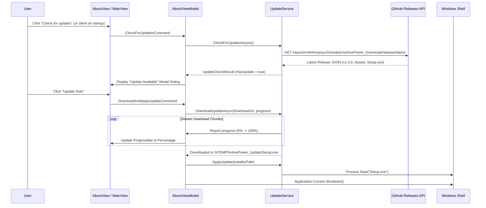

# AxePower: Intelligent Power Management & Gaming Optimizer for Windows

<div align="center">

%20%7C%20Windows%2011-0078D4?logo=windows&logoColor=white)


**Intelligently optimizes your system's power usage, display refresh rates, and background processes to deliver the perfect balance between performance, battery life, and cooling—automatically.**

[Official Website](https://axepower.vercel.app/) • [Download Latest Release](https://github.com/mrAbhimanyuVishwakarma/AxePower_Download/releases) • [Help Center](https://axepower.vercel.app/help.html) • [Report Issue](https://github.com/mrAbhimanyuVishwakarma/AxePower_Download/issues) • [Developer Profile](https://github.com/mrAbhimanyuVishwakarma)

</div>

## 🚀 Key Features

- ⚡ **Intelligent Power Modes**: Seamlessly switch between **Eco**, **Smart**, **Beast**, and **Game** modes tailored for battery savings or extreme performance.
- 📊 **Live Hardware & Task Manager Performance Monitor**: Real-time 2x2 performance grid tracking **CPU** clock, **GPU** 3D engine utilization & temperature, **RAM** allocation, and **Internet** transfer speeds with precise zero-baseline sparkline graphs.
- 🔋 **24-Hour Battery History**: Dedicated full-width battery diagnostics tracking 24-hour battery percentage trends with time-axis markers (`24h ago`, `12h ago`, `Now`).
- ⚙️ **Smart Performance Defaults**: Out-of-the-box defaults set to **Smart Mode** for AC power and **Eco Mode** on battery, with custom dropdown configuration in Settings.
- 🎮 **Controller Navigation (Gopher360)**: Full gamepad-to-mouse emulation with custom key shortcuts in Game Mode and smooth horizontal scrollable guide tabs.
- 📌 **Steam-Style Taskbar Context Menu**: Dark Steam slate aesthetic with full-width dividers, direct 1-click power mode switching (Eco, Smart, Beast, Game Mode), and quick launcher shortcuts.
- 📜 **Steam Update Banner & Scrollable Patch Notes**: Steam Cyan/Blue bottom banner with complete scrollable changelog feed, reaction bar (`👍 Rate Up`, `👎`, `💬 Discuss`, `🔗 Share`), and smooth scroll arrows.
- 🚀 **Silent Background Auto-Updater**: Native update engine that checks for latest releases, streams installer downloads in the background with zero disruption, and provides 1-click "Restart & Install".
- 🛍️ **Software Hub & Ninite Multi-Installer**:
  - **Ninite Integration**: Bundled local multi-installer + online custom package builder for zero-click multi-app setups.
  - **Expanded Suite**: Audacity, OBS Studio, DaVinci Resolve, GIMP, Canva, Blender, HandBrake, PowerToys, ShareX, Peace Equalizer, Dolby Access, SteelSeries GG Sonar, and hardware diagnostic utilities.
- 📱 **Phone Control (All-in-One Mobile Suite)**:
  - 🖥️ **SpaceDesk Second Monitor**: Turn any Android tablet, iPad, or browser into an extended PC display with 1-click driver installation and QR code downloads *(Credit to DATRONICSOFT)*.
  - 🔗 **Microsoft Phone Link**: Instant launch integration and companion QR pairing modals for Link to Windows on Android and iOS.
  - 📂 **LAN Drop (Wi-Fi Quick Share)**: Instant offline file drop and clipboard note sync between PC and phone via dynamic QR code without requiring apps on the phone *(Credit to yadavnikhil03)*.
  - 📱 **Android Screen Mirroring (scrcpy)**: Ultra-low latency device mirroring, stay-awake / screen-off power toggles, resolution & FPS presets, and 1-click APK sideloading *(Credit to Genymobile)*.
- 📖 **Dedicated Help & Documentation Center**: Direct in-app `? Help` title bar button and "Learn More" links connecting to the official [AxePower Help Center](https://axepower.vercel.app/help.html).
- 🔄 **Smart Auto-Switch**: Automatically applies power plans and adjusts display refresh rates (e.g. 60Hz on battery vs 144Hz/165Hz/240Hz on AC power) whenever power states change.
- 🗑️ **Uninstaller Pro**: Deep application discovery, batch uninstallation, and verified leftover registry/filesystem cleaner with safety backups.
- 🔄 **Update PC Utility & BIOS Checks**: Elevated one-click driver and Windows update management via Windows Package Manager (`winget`) and BIOS/firmware version checks.
- 🧹 **Win11Debloat Integration**: One-click elevated execution of Windows optimization and telemetry removal scripts *(Credit to Raphire)*.
- 📊 **MSI Afterburner Companion**: Fast-launch and focus integration for GPU tuning, fan curves, and in-game statistics *(Credit to MSI / Guru3D)*.
- 🔒 **100% Local & Privacy-First**: Zero telemetry, zero analytics tracking, and zero remote data collection.

---

## 🖥️ User Interface & Navigation

AxePower provides a centralized desktop hub with a dedicated sidebar:

| Section | Icon | Purpose |
| :--- | :---: | :--- |
| **CONTROL** | | |
| **Dashboard** | 📊 | Real-time system monitoring, power mode switching (Eco, Smart, Beast, Game Mode), live 2x2 performance grid (CPU, GPU, RAM, Internet), and 24h battery history. |
| **Auto Switch** | 🔄 | Configure automated rules for AC (Plugged In) and DC (Battery) states and dynamic refresh rate switching. |
| **Game Mode** | 🎮 | Manage background app suspension, game detection, and Controller Navigation (Gopher360). |
| **Battery** | 🔋 | Comprehensive battery diagnostics, health percentages, and charging trends with custom icon cards. |
| **CONNECTION** | | |
| **📱 Phone Control** | 📱 | All-in-one mobile suite: SpaceDesk wireless display, LAN Drop Wi-Fi share, and Android screen mirroring *(scrcpy)*. |
| **MAINTENANCE** | | |
| **⚡ Optimizer** | ⚡ | Safe Windows debloat, telemetry removal, and system performance optimizations. |
| **🩺 Doctor** | 🩺 | Windows system health repair (SFC/DISM), shader cache cleaner, and DNS benchmark. |
| **UTILITIES** | | |
| **✈️ MSI Afterburner** | ✈️ | Dedicated GPU overclocking and OSD launcher with built-in guide modal *(Credit to MSI)*. |
| **🗑️ Uninstaller Pro** | 🗑️ | Comprehensive app discovery, batch uninstallation, and leftover cleaner. |
| **🔄 Update PC** | 🔄 | Elevated one-click driver and package updates. |
| **🧹 Debloat** | 🧹 | Win11Debloat by Raphire integration. |
| **FOOTER (PINNED)** | | |
| **⚙️ Settings** | ⚙️ | Application preferences, performance defaults, startup toggles, and notification settings. |
| **ℹ️ About** | ℹ️ | License details, system compatibility, update checker, and official website links. |

---

## 🏛️ High-Level Architecture

AxePower is built on a Domain-Driven Design (DDD) layered architecture using `CommunityToolkit.Mvvm`:

```mermaid
flowchart TD
    subgraph Presentation Layer [AxePower.App]
        Views[WPF Views & Fluent XAML]
        VMs[CommunityToolkit MVVM ViewModels]
        Tray[Hardcodet System Tray & ContextMenu]
        DI[Microsoft.Extensions.DependencyInjection]
        
        Views <--> VMs
        VMs --> DI
        Tray --> VMs
    end

    subgraph Core Business Layer [AxePower.Core]
        OS_SVC[Orchestration Services]
        HW_INT[Hardware & Native Integrations]
        UNINST[Uninstaller Pro Engine]
        MOBILE[Phone Control & LAN Drop Engine]
        WINGET[WinGet Hub & Software Catalog]
        DATA[Configuration & Logging]
        UPD[Auto-Update Service]
        
        OS_SVC --> HW_INT
        OS_SVC --> UNINST
        OS_SVC --> MOBILE
        OS_SVC --> WINGET
        OS_SVC --> DATA
        UPD --> GitHubAPI[(GitHub Releases API)]
    end

    VMs --> Core Business Layer

    OS_SVC --> AutoSwitch[AutoSwitchService]
    OS_SVC --> AppMonitor[AppMonitorService]
    OS_SVC --> GameScanner[GameScannerService]
    OS_SVC --> Debloat[DebloatService]
    OS_SVC --> DriverUpdate[DriverUpdateService]
    OS_SVC --> Msi[MsiAfterburnerService]

    MOBILE --> LanDrop[LanDropService (TcpListener & Embedded Web Portal)]
    MOBILE --> AndroidCtrl[AndroidControlService (scrcpy & ADB Bridge)]

    WINGET --> WinGetHub[WinGetHubService (3-Stage Resilient Installer)]

    UNINST --> AppDiscovery[ApplicationDiscoveryService]
    UNINST --> BatchUninstall[BatchUninstallService]
    UNINST --> LeftoverScanner[LeftoverScannerService]
    UNINST --> RegBackup[RegistryBackupService]

    HW_INT --> PowerCfg[PowerPlanService (powercfg)]
    HW_INT --> Battery[BatteryService (Win32 API)]
    HW_INT --> Display[DisplayService (ChangeDisplaySettingsEx)]
    HW_INT --> AppKiller[AppKillerService (Process/NT Suspend)]

    DATA --> Settings[SettingsService (Encrypted JSON)]
    DATA --> Log[LogService]
```

---

## 🛠️ Auto-Update Flow



---

## 💻 Development & Build Guide

### Prerequisites
- [.NET 8.0 SDK](https://dotnet.microsoft.com/download/dotnet/8.0) (or Visual Studio 2022 v17.8+)
- Windows 10 (Build 1809+) or Windows 11 (64-bit)

### Running Locally
```bash
# Clone the repository
git clone https://github.com/mrAbhimanyuVishwakarma/AxePower.git
cd AxePower

# Restore and build the solution
dotnet build

# Run the WPF application
dotnet run --project AxePower.App/AxePower.App.csproj
```

### Running Unit Tests
```bash
dotnet test
```

### Publishing a Release Build
```bash
dotnet publish AxePower.App/AxePower.App.csproj -c Release -r win-x64 --self-contained false -p:PublishSingleFile=false
```

### Creating the Inno Setup Installer
1. Install [Inno Setup 6](https://jrsoftware.org/isinfo.php).
2. Open `Installer/AxePowerSetup.iss`.
3. Press `Ctrl + F9` to compile the installer into `Installer/Output/AxePower-Setup.exe`.

---

## 📜 Third-Party Credits & Acknowledgements

AxePower proudly integrates with and acknowledges tools created by the open-source and enthusiast community:

- **[spacedesk](https://www.spacedesk.net/)**: Multi-monitor virtual display network extension engine by **datronicsoft Technology GmbH**.
- **[scrcpy](https://github.com/Genymobile/scrcpy)**: High-performance Android screen mirroring and control engine by **Genymobile**.
- **[LAN-DropSpot](https://github.com/yadavnikhil03/LAN-DropSpot.git)**: Wi-Fi local file drop & sharing inspiration by **Nikhil Yadav (`yadavnikhil03`)**.
- **[Win11Debloat](https://github.com/Raphire/Win11Debloat)**: Windows debloating and telemetry optimization scripts created by **Raphire**.
- **[MSI Afterburner & RTSS](https://www.msi.com/Landing/afterburner/graphics-cards)**: Hardware statistics and GPU monitoring by **MSI** and **Alexey Nicolaychuk (Guru3D / RivaTuner)**.
- **[DaVinci Resolve](https://www.blackmagicdesign.com/products/davinciresolve)**: Professional video editing and color grading by **Blackmagic Design**.
- **[Hardcodet WPF TaskbarNotification](https://github.com/hardcodet/wpf-notifyicon)**: System tray icon integration for WPF by **Philipp Sumi**.
- **[CommunityToolkit.Mvvm](https://github.com/CommunityToolkit/dotnet)**: Modern, high-performance MVVM library by the **.NET Foundation & Microsoft**.
- **Windows Package Manager (`winget`) & USOClient**: Package and driver update orchestration by **Microsoft Corporation**.

> *Notice: All trademarks, product names, and brand logos belong to their respective owners. AxePower functions as an independent, open-source orchestration companion. If you are an author or copyright holder of any included component and have questions, concerns, or requests for modification/removal, please open an issue and we will gladly accommodate.*

---

## 👤 Author & Support

- **Developed by**: [Abhimanyu Vishwakarma](https://github.com/mrAbhimanyuVishwakarma)
- **Official Download Repo**: [AxePower_Download](https://github.com/mrAbhimanyuVishwakarma/AxePower_Download)
- **Issue Tracker & Support**: [GitHub Issues](https://github.com/mrAbhimanyuVishwakarma/AxePower_Download/issues)

*If you find AxePower helpful, please consider starring the repository on GitHub!*
