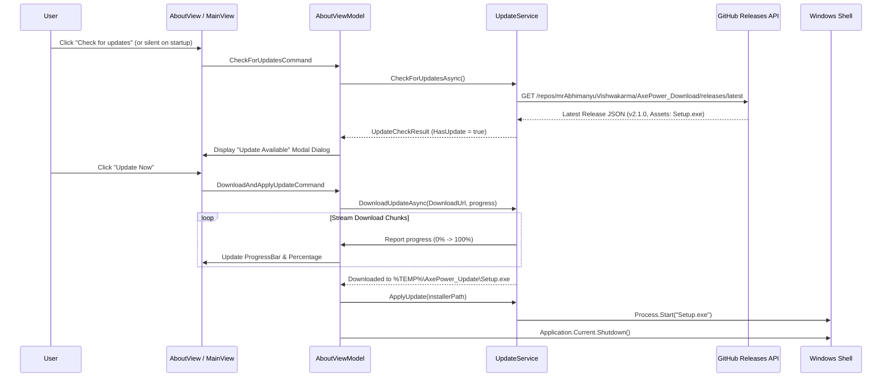

# AxePower: Intelligent Power Management & Gaming Optimizer for Windows

<div align="center">


[](LICENSE)


[Security Policy](SECURITY.md) | [Contributing](CONTRIBUTING.md) | [Third-Party Notices](THIRD_PARTY_NOTICES.md)

**Intelligently optimizes your system's power usage, display refresh rates, and background processes to deliver the perfect balance between performance, battery life, and cooling—automatically.**

[Official Website](https://axepower.vercel.app/) • [Download Latest Release](https://github.com/mrAbhimanyuVishwakarma/AxePower_Download/releases) • [Help Center](https://axepower.vercel.app/help.html) • [Report Issue](https://github.com/mrAbhimanyuVishwakarma/AxePower_Download/issues) • [Developer Profile](https://github.com/mrAbhimanyuVishwakarma)

</div>

## 🚀 Key Features

- 🧰 **System Care Workspace**: Optimizer and Doctor are unified behind a collapsible category rail, with recommended tweaks, repair actions, restore points, junk cleanup, DNS switching, and live terminal output in one place.
- 🛡️ **Windows Update and Update Shield**: Review available Windows, app, and device updates from one page. Update Shield lets you configure feature-update deferral and signed-in restart protection where Windows policy allows, repair the update download cache, and request a restore point.
- 🗂️ **Table-Based Uninstaller Pro**: Full-width Win32 and Windows Apps views with file-type badges, sortable columns, ascending/descending alphabetical order, batch selection, broken-entry filtering, and a Select All action for detected leftovers.
- 🧭 **Responsive Software Hub**: A collapsible category rail for runtimes, gaming, hardware tuning, and utilities. Install controls stay inline when space permits and move below content only in compact layouts.
- 🎵 **Integrated Music Player & Media Hub**: Built-in high-fidelity audio engine supporting local libraries and YouTube Music streaming. Features an aesthetic Header Player matching the dashboard design and automatically follows default Windows audio output device switches.
- 🗑️ **Next-Gen Uninstaller Pro**: Deep leftover scanner with confidence scoring, registry backup manifests, broken uninstaller recovery, and PowerShell execution safety nets.
- 🖥️ **Built-In Terminal (CMD & PowerShell)**: A persistent interactive shell inside the app, and the single place every command AxePower runs reports to — Software Hub installs and System Doctor diagnostics stream their live output here, with a **Stop** button that cancels the running task.
- 🛡️ **Optional Administrator Mode**: Fresh installs ask before enabling elevation. Use **Run as administrator** in Settings or **Relaunch with Admin** from the title bar. The Windows logon task follows that setting.
- 🌡️ **Real CPU & GPU Temperatures (Driver-Free)**: A three-tier sensor stack — Lenovo's ACPI-WMI firmware interface, MSI Afterburner's shared memory, then LibreHardwareMonitor — so readings keep working on machines with **Memory Integrity / the vulnerable-driver blocklist enabled**, where MSR-only tools silently return nothing.
- 💾 **One-Click System Restore Point**: Create a Windows restore point straight from the Software Hub before you change anything, with the 24-hour creation throttle lifted so the checkpoint is actually written.
- 🪟 **Glass Theme (Mica & Acrylic)**: True Windows 11 DWM backdrops with an Acrylic blur-behind fallback for Windows 10, alongside System / Dark / Light.
- ⚡ **Intelligent Power Modes**: Seamlessly switch between **Eco**, **Smart**, **Beast**, and **Game** modes tailored for battery savings or extreme performance.
- 🎮 **Game Mode**: Discover games from Steam, Epic, GOG, Xbox game folders, and other common install folders. The Dashboard shortcut opens the Game Mode page, where you can apply the mode and manage per-game settings. Game art comes from Steam.
- 🕹️ **Controller Navigation (Xbox & PlayStation DualSense)**: Full gamepad-to-mouse emulation supporting Xbox (360 / One / Series X|S) and PlayStation (DualShock 4 / DualSense) controllers with in-app visual shortcut guides.
- ⚡ **GPU Control Companion Integration**: Seamless 1-click companion launcher and auto-detection for **Lenovo Legion Toolkit**, **Lenovo Vantage**, **ASUS Armoury Crate**, and **MSI Center**.
- 📊 **Live Hardware & Task Manager Performance Monitor**: Real-time 2x2 performance grid tracking **CPU** clock, **GPU** 3D engine utilization & temperature, **RAM** allocation, and **Internet** transfer speeds with precise zero-baseline sparkline graphs.
- 🔋 **24-Hour Battery History**: Dedicated full-width battery diagnostics tracking 24-hour battery percentage trends with time-axis markers (`24h ago`, `12h ago`, `Now`).
- ⚙️ **Smart Performance Defaults**: Out-of-the-box defaults set to **Smart Mode** for AC power and **Eco Mode** on battery, with custom dropdown configuration in Settings.
- 📌 **Steam-Style Taskbar Context Menu**: Dark Steam slate aesthetic with full-width dividers, direct 1-click power mode switching (Eco, Smart, Beast, Game Mode), and quick launcher shortcuts.
- 📜 **Steam Update Banner & Scrollable Patch Notes**: Steam Cyan/Blue bottom banner with complete scrollable changelog feed, reaction bar (`👍 Rate Up`, `👎`, `💬 Discuss`, `🔗 Share`), and smooth scroll arrows.
- 🚀 **Reliable Background Auto-Updater**: Native update engine with shared background/manual downloads, slow-network tolerance, visible progress, verified partial files, installer validation, and 1-click launch.
- 🛍️ **Software Hub & Ninite Multi-Installer**:
  - **Ninite Integration**: Bundled local multi-installer + online custom package builder for zero-click multi-app setups.
  - **Expanded Suite**: Audacity, OBS Studio, DaVinci Resolve, GIMP, Canva, Blender, HandBrake, PowerToys, ShareX, Peace Equalizer, Dolby Access, SteelSeries GG Sonar, and hardware diagnostic utilities.
- 📱 **Phone Control (All-in-One Mobile Suite)**:
  - 🖥️ **SpaceDesk Second Monitor**: Turn any Android tablet, iPad, or browser into an extended PC display with 1-click driver installation and QR code downloads *(Credit to DATRONICSOFT)*.
  - 🔗 **Microsoft Phone Link**: Instant launch integration and companion QR pairing modals for Link to Windows on Android and iOS.
  - 📂 **LAN Drop (Wi-Fi Quick Share)**: Instant offline file drop and clipboard note sync between PC and phone via dynamic QR code without requiring apps on the phone *(Credit to yadavnikhil03)*.
  - 📱 **Android Screen Mirroring (scrcpy)**: Ultra-low latency device mirroring, stay-awake / screen-off power toggles, resolution & FPS presets, and 1-click APK sideloading *(Credit to Genymobile)*.
- 📖 **Dedicated Help & Documentation Center**: Direct in-app `? Help` title bar button and "Learn More" links connecting to the official [AxePower Help Center](https://axepower.vercel.app/help.html).
- 🔄 **Smart Auto-Switch**: Automatically applies power plans and adjusts display refresh rates (e.g. 60Hz on battery vs 144Hz/165Hz/240Hz on AC power) whenever power states change.
- 🔄 **WinGet and device updates**: Confirm exact app upgrades or run a separate bulk upgrade, then review the results and any restart requirement. Windows Settings, Microsoft Store, and official vendor tools handle their own Windows, Store, driver, and firmware installs.
- 🧹 **Win11Debloat Integration**: Launches Raphire's Win11Debloat script with administrator rights after a confirmation that says plainly what it is: a third-party script whose changes AxePower cannot list or undo *(Credit to Raphire)*.
- 📊 **MSI Afterburner Companion**: Fast-launch and focus integration for GPU tuning, fan curves, and in-game statistics *(Credit to MSI / Guru3D)*.
- 🔒 **Private by Default, Honest About the Network**: No ads and no usage analytics. Accounts are optional; without one, nothing about you is stored in AxePower's cloud. Every connection AxePower makes, what triggers it and what it sends is listed in [docs/security/PRIVACY.md](docs/security/PRIVACY.md) and on the in-app **Trust & Permissions** page.

---

## 🖥️ User Interface & Navigation

AxePower provides a centralized desktop hub with a dedicated sidebar:

| Section | Icon | Purpose |
| :--- | :---: | :--- |
| **CONTROL** | | |
| **Dashboard** | 📊 | Real-time system monitoring, power mode switching (Eco, Smart, Beast, Game Mode), live 2x2 performance grid (CPU, GPU, RAM, Internet), and 24h battery history. |
| **Auto Switch** | 🔄 | Configure automated rules for AC (Plugged In) and DC (Battery) states and dynamic refresh rate switching. |
| **Game Mode** | 🎮 | Multi-platform game library scanner, SteamGridDB vertical posters, GPU control companion, background app suspension, and Xbox / PS5 Controller Navigation. |
| **Battery** | 🔋 | Comprehensive battery diagnostics, health percentages, and charging trends with custom icon cards. |
| **Music** | 🎵 | Integrated music playback, local library scanning, YouTube Music streaming, and a sleek header player. |
| **CONNECTION** | | |
| **📱 Phone Control** | 📱 | All-in-one mobile suite: SpaceDesk wireless display, LAN Drop Wi-Fi share, and Android screen mirroring *(scrcpy)*. |
| **MAINTENANCE** | | |
| **🛡️ Windows Update** | 🛡️ | Discover Windows, app, and device updates, confirm WinGet upgrades, review results, and open Update Shield for policy, repair, and restore points. |
| **🧰 System Care** | 🧰 | Recommended optimizations, SFC/DISM health repair, junk cleanup, DNS tools, and other guarded maintenance actions. |
| **🗑️ Uninstaller** | 🗑️ | Sortable Win32/Windows Apps inventory, batch uninstall, broken-entry handling, and selectable leftovers. |
| **🧹 Debloat** | 🧹 | Win11Debloat by Raphire integration. |
| **UTILITIES** | | |
| **🖥️ Terminal** | 🖥️ | Built-in CMD / PowerShell session and the shared output console for every command AxePower runs. |
| **🛠️ Tools** | 🛠️ | Trusted monitoring and cleanup utilities, Timer, and Routines. |
| **FOOTER (PINNED)** | | |
| **⚙️ Settings** | ⚙️ | Application preferences, performance defaults, theme (System / Dark / Light / Glass), **Run as administrator**, startup toggles, and notification settings. |
| **ℹ️ About** | ℹ️ | License details, system compatibility, update checker, and official website links. |

---

## 🏛️ High-Level Architecture

AxePower is built on a Domain-Driven Design (DDD) layered architecture using `CommunityToolkit.Mvvm`:

```mermaid
flowchart TD
    subgraph Presentation Layer [AxePower.App]
        Views[WPF Views & Fluent XAML]
        VMs[CommunityToolkit MVVM ViewModels]
        Tray[Hardcodet System Tray & ContextMenu]
        DI[Microsoft.Extensions.DependencyInjection]
        
        Views <--> VMs
        VMs --> DI
        Tray --> VMs
    end

    subgraph Core Business Layer [AxePower.Core]
        OS_SVC[Orchestration Services]
        HW_INT[Hardware & Native Integrations]
        UNINST[Uninstaller Pro Engine]
        MOBILE[Phone Control & LAN Drop Engine]
        WINGET[WinGet Hub & Software Catalog]
        DATA[Configuration & Logging]
        UPD[Auto-Update Service]
        
        OS_SVC --> HW_INT
        OS_SVC --> UNINST
        OS_SVC --> MOBILE
        OS_SVC --> WINGET
        OS_SVC --> DATA
        UPD --> GitHubAPI[(GitHub Releases API)]
    end

    VMs --> Core Business Layer

    OS_SVC --> AutoSwitch[AutoSwitchService]
    OS_SVC --> AppMonitor[AppMonitorService]
    OS_SVC --> GameScanner[GameScannerService]
    OS_SVC --> Debloat[DebloatService]
    OS_SVC --> DriverUpdate[DriverUpdateService]
    OS_SVC --> Msi[MsiAfterburnerService]

    MOBILE --> LanDrop[LanDropService (TcpListener & Embedded Web Portal)]
    MOBILE --> AndroidCtrl[AndroidControlService (scrcpy & ADB Bridge)]

    WINGET --> WinGetHub[WinGetHubService (3-Stage Resilient Installer)]

    UNINST --> AppDiscovery[ApplicationDiscoveryService]
    UNINST --> BatchUninstall[BatchUninstallService]
    UNINST --> LeftoverScanner[LeftoverScannerService]
    UNINST --> RegBackup[RegistryBackupService]

    HW_INT --> PowerCfg[PowerPlanService (powercfg)]
    HW_INT --> Battery[BatteryService (Win32 API)]
    HW_INT --> Display[DisplayService (ChangeDisplaySettingsEx)]
    HW_INT --> AppKiller[AppKillerService (Process/NT Suspend)]
    HW_INT --> HwMon[HardwareMonitorService (3-tier sensor fallback)]

    HwMon --> LenovoWmi[LenovoSensorReader (ACPI-WMI, driver-free)]
    HwMon --> Afterburner[AfterburnerSensorReader (MAHM shared memory)]
    HwMon --> LHM[LibreHardwareMonitor (MSR via kernel driver)]

    OS_SVC --> Term[TerminalService (persistent shell & shared output bus)]
    OS_SVC --> Elev[ElevationService (asInvoker + runas relaunch)]
    OS_SVC --> Restore[RestorePointService (Checkpoint-Computer)]

    DATA --> Settings[SettingsService (Encrypted JSON)]
    DATA --> Log[LogService]
```

---

## 🛠️ Auto-Update Flow



---

## 💻 Development & Build Guide

### Prerequisites

- [.NET 10 SDK](https://dotnet.microsoft.com/download/dotnet/10.0). Local release verification uses SDK 10.0.404.
- The release targets Intel and AMD x64 Windows 11 desktops. Windows 10 build 17763 is the minimum API version declared in source. Windows 10 coverage depends on OS servicing, the .NET 10 prerequisites, and release validation. Windows 11 on Arm may run the x64 build under emulation. Arm64 coverage requires separate validation. [Microsoft's Windows requirements for .NET 10](https://learn.microsoft.com/en-us/dotnet/core/install/windows#supported-versions)
- The framework-dependent app uses the x64 .NET 10 Desktop Runtime. Setup checks for 10.0.15 or a newer 10.0.x patch and downloads a verified Microsoft installer when needed. For offline setup, install the x64 Desktop Runtime first. [Microsoft .NET 10 downloads](https://dotnet.microsoft.com/download/dotnet/10.0)
- WinGet actions require a usable App Installer/WinGet setup in the current Windows session. Sources, hardware features, and policy controls depend on the device and account. See the [Windows Update compatibility and rollout plan](docs/engineering/WINDOWS_UPDATE_PLAN.md).

### Running Locally
```powershell
# Clone the repository
git clone https://github.com/mrAbhimanyuVishwakarma/AxePower.git
cd AxePower

# Build and open the app from this checkout
powershell -ExecutionPolicy Bypass -File scripts/run-latest.ps1
```

The script prints the checked-out branch, commit, and executable version. If AxePower is already running, exit it through the tray first. See [AGENTS.md](AGENTS.md) for the current development branch and [CONTRIBUTING.md](CONTRIBUTING.md) for locked restore, build, and test commands.

### Running Unit Tests
```bash
dotnet test AxePower.sln -c Release -p:RestoreLockedMode=true
```

### Publishing a Release Build
```bash
dotnet publish AxePower.App/AxePower.App.csproj -c Release -r win-x64 --self-contained false -p:PublishSingleFile=false
```

### Creating the Inno Setup Installer

Install [Inno Setup 6](https://jrsoftware.org/isinfo.php), then run:

```powershell
powershell -ExecutionPolicy Bypass -File scripts/package-release.ps1
```

The [release pipeline](docs/engineering/RELEASE_PIPELINE.md) builds Setup from a fresh x64 publish and copies it to `Installer/Output/AxePower-v<version>-Setup.exe`. Setup checks for the x64 .NET 10 Desktop Runtime and downloads the Microsoft installer when needed.

### Repository guide

| Path | Contents |
|---|---|
| `AxePower.App/`, `AxePower.Core/`, `AxePower.Tests/` | WPF app, Windows and feature services, and xUnit tests |
| `Installer/`, `scripts/`, `tools/` | Setup, development and release commands, and update-signing tool |
| `AppWebsite/` | Static product website. Use `localtest.bat` to preview it locally. |
| `supabase/` | Account functions, database migrations, and policy tests |
| `skins/`, `skillsMD/`, `docs/` | Skins, feature guides, and engineering, security, and release documentation |

---

## 📜 Third-Party Credits & Acknowledgements

AxePower proudly integrates with and acknowledges tools created by the open-source and enthusiast community:

- **[spacedesk](https://www.spacedesk.net/)**: Multi-monitor virtual display network extension engine by **datronicsoft Technology GmbH**.
- **[scrcpy](https://github.com/Genymobile/scrcpy)**: High-performance Android screen mirroring and control engine by **Genymobile**.
- **[LAN-DropSpot](https://github.com/yadavnikhil03/LAN-DropSpot.git)**: Wi-Fi local file drop & sharing inspiration by **Nikhil Yadav (`yadavnikhil03`)**.
- **[Win11Debloat](https://github.com/Raphire/Win11Debloat)**: Windows debloating and telemetry optimization scripts created by **Raphire**.
- **[MSI Afterburner & RTSS](https://www.msi.com/Landing/afterburner/graphics-cards)**: Hardware statistics and GPU monitoring by **MSI** and **Alexey Nicolaychuk (Guru3D / RivaTuner)**.
- **[DaVinci Resolve](https://www.blackmagicdesign.com/products/davinciresolve)**: Professional video editing and color grading by **Blackmagic Design**.
- **[Hardcodet WPF TaskbarNotification](https://github.com/hardcodet/wpf-notifyicon)**: System tray icon integration for WPF by **Philipp Sumi**.
- **[CommunityToolkit.Mvvm](https://github.com/CommunityToolkit/dotnet)**: Modern, high-performance MVVM library by the **.NET Foundation & Microsoft**.
- **Windows Package Manager (`winget`) & USOClient**: Package and driver update orchestration by **Microsoft Corporation**.
- **[Bulk Crap Uninstaller](https://github.com/BCUninstaller/Bulk-Crap-Uninstaller)**: Uninstaller Pro adapts parts of its uninstaller detection, process-tree waiting and leftover-evidence model, by **Marcin Szeniak** (Apache-2.0).

Full license texts and notices for bundled and adapted components are in [THIRD_PARTY_NOTICES.md](THIRD_PARTY_NOTICES.md).

AxePower itself is distributed under the [MIT License](LICENSE). Please read [CONTRIBUTING.md](CONTRIBUTING.md) before proposing a change. Report suspected vulnerabilities privately according to [SECURITY.md](SECURITY.md), not through a public issue.

> *Notice: All trademarks, product names, and brand logos belong to their respective owners. AxePower functions as an independent, open-source orchestration companion. If you are an author or copyright holder of any included component and have questions, concerns, or requests for modification/removal, please open an issue and we will gladly accommodate.*

---

## 👤 Author & Support

- **Developed by**: [Abhimanyu Vishwakarma](https://github.com/mrAbhimanyuVishwakarma)
- **Official Download Repo**: [AxePower_Download](https://github.com/mrAbhimanyuVishwakarma/AxePower_Download)
- **Issue Tracker & Support**: [GitHub Issues](https://github.com/mrAbhimanyuVishwakarma/AxePower_Download/issues)

*If you find AxePower helpful, please consider starring the repository on GitHub!*
