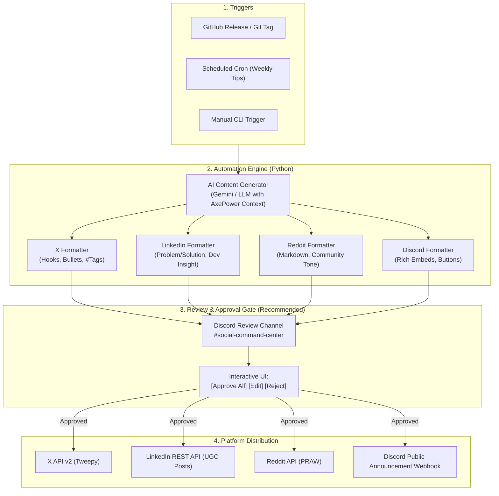

# AxePower Social Media Automation System

Comprehensive automation engine for distributing release announcements, feature spotlights, battery health tips, and community updates across **X (Twitter)**, **LinkedIn**, **Reddit**, and **Discord**.

---

## 1. System Architecture



---

## 2. Platform Setup & Credential Guide

### A. Discord (Command & Review Gate + Public Announcements)
1. **Bot Token:** Created in the [Discord Developer Portal](https://discord.com/developers/applications).
   - Bot permissions needed: `Send Messages`, `Embed Links`, `Attach Files`, `Read Message History`, `Use Slash Commands`.
   - Your existing bot invite link:
     ```text
     https://discord.com/oauth2/authorize?client_id=1544597126946758757&permissions=8&integration_type=0&scope=bot+applications.commands
     ```
2. **Review Channel:** Create a private channel in your server (e.g. `#social-command-center`) where drafts will be posted for one-click approval.
3. **Public Announcement Webhook:** In your public community Discord, go to **Channel Settings > Integrations > Webhooks** and copy the webhook URL for `#announcements`.

---

### B. X (Twitter)
1. Navigate to the [Twitter Developer Portal](https://developer.x.com/en/portal/dashboard).
2. Create a project under the **Free Tier** (allows up to 1,500 tweet writes/month).
3. Under **User authentication settings**, set App permissions to **Read and Write**.
4. Generate the following 4 keys from the "Keys and Tokens" tab:
   - `TWITTER_API_KEY` (Consumer Key)
   - `TWITTER_API_SECRET` (Consumer Secret)
   - `TWITTER_ACCESS_TOKEN`
   - `TWITTER_ACCESS_TOKEN_SECRET`

---

### C. LinkedIn
1. Open the [LinkedIn Developer Portal](https://www.linkedin.com/developers/apps).
2. Create an App named `AxePower` and link your LinkedIn Company Page or Personal Profile.
3. Add the **Share on LinkedIn** and **Sign In with LinkedIn using OpenID Connect** products.
4. Generate an OAuth 2.0 Access Token with scopes `w_member_social` (for personal profile) or `w_organization_social` (for company page).
5. Obtain:
   - `LINKEDIN_CLIENT_ID`
   - `LINKEDIN_CLIENT_SECRET`
   - `LINKEDIN_ACCESS_TOKEN`
   - `LINKEDIN_PERSON_URN` or `LINKEDIN_ORG_ID`

---

### D. Reddit
1. Log into Reddit and navigate to [https://www.reddit.com/prefs/apps](https://www.reddit.com/prefs/apps).
2. Click **Create another app...** (or create app).
3. Select **script** (for personal use/automation).
4. Fill in:
   - Name: `AxePower-Bot`
   - Redirect URI: `http://localhost:8080`
5. Note the App ID (under the app name) and the App Secret.
6. Gather credentials:
   - `REDDIT_CLIENT_ID`
   - `REDDIT_CLIENT_SECRET`
   - `REDDIT_USERNAME`
   - `REDDIT_PASSWORD`
   - `REDDIT_USER_AGENT`: `windows:axepower.social:v1.0 (by /u/YOUR_USERNAME)`

> [!WARNING]
> **Reddit Community Guidelines:** Tech subreddits (e.g., `r/windows`, `r/laptops`, `r/pcmasterrace`, `r/software`) strictly forbid overt promotional spam. Posts should focus on engineering insights, benchmarks, open-source announcements, or solving genuine battery/power throttling issues.

---

## 3. Directory Layout (`D:\Projects\AxePower\Social Media`)

```text
Social Media/
├── socialautomation.md       # Complete documentation & workflow guide (this file)
├── requirements.txt          # Python dependencies (tweepy, praw, discord.py, etc.)
├── .env.example              # Template for API keys
├── .env                      # Local secret keys (git-ignored)
├── config.py                 # Configuration loader & validation
├── generator.py              # LLM prompt generator tailored per platform
├── post_orchestrator.py      # Main pipeline (generate -> review -> publish)
└── platforms/
    ├── __init__.py
    ├── discord_client.py     # Discord embeds & review message UI
    ├── x_client.py           # X/Twitter posting via Tweepy
    ├── linkedin_client.py    # LinkedIn UGC post dispatch
    └── reddit_client.py      # Reddit submission dispatch via PRAW
```

---

## 4. Platform-Specific Copy Strategy

The generator adapts copy specifically to the culture of each platform:

| Platform | Tone & Focus | Structure | Link Target |
| :--- | :--- | :--- | :--- |
| **X** | High-energy, punchy hook, problem/benefit | • 1 Hook sentence<br>• 2-3 Bullet points<br>• Link & 3-4 hashtags | Website download page or GitHub Release |
| **LinkedIn** | Professional, tech-journey, performance optimization | • Problem context (e.g. laptop battery degradation)<br>• How AxePower solves it<br>• Call to action | AxePower Website / GitHub |
| **Reddit** | Honest, developer-to-user, authentic, no hype | • Descriptive self-post title<br>• Context & detailed changelog<br>• Open question asking for feedback | GitHub Releases / Free Download |
| **Discord** | Community-first, rich formatting, emojis | • Color-coded embed<br>• Release highlights & download buttons<br>• Known issues / discussion prompt | Direct download link |

---

## 5. Execution Workflows

### Manual CLI Trigger
Generate drafts for a specific topic or release:
```bash
python post_orchestrator.py --topic "AxePower v1.2: Added Smart 80% Battery Charge Limit" --mode review
```

Publish directly without waiting for Discord review:
```bash
python post_orchestrator.py --topic "Tip: How background apps drain laptop batteries in sleep mode" --platforms x,discord --mode direct
```

---

## 6. GitHub CI/CD Automated Release Trigger

When a new version tag is pushed (e.g. `git tag v1.2.0 && git push --tags`), a GitHub Action `.github/workflows/social_release.yml` will automatically:
1. Extract release notes from GitHub Release.
2. Run `post_orchestrator.py` with the release notes as input.
3. Post the interactive draft cards to Discord for instant one-click approval before going live.
