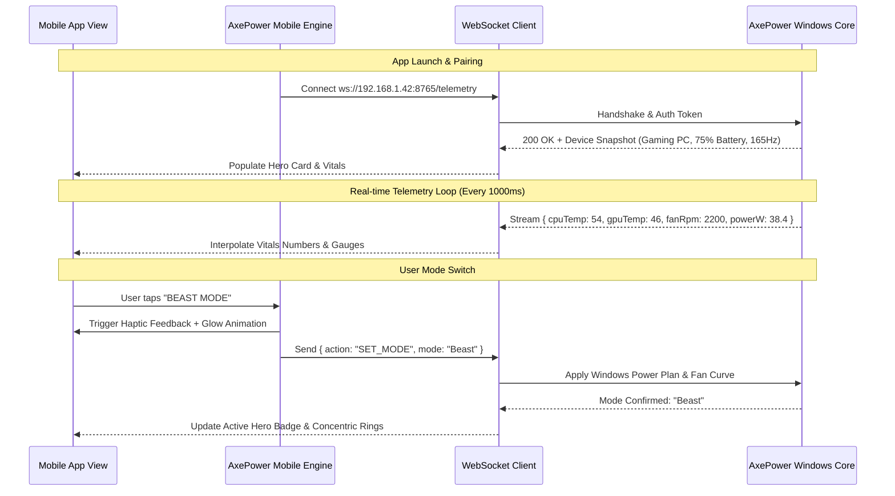

# AxePower Mobile — Pixel-Perfect UI/UX Design & Architecture Specification

> **Target Platform:** Android & iOS (React Native / Flutter / Jetpack Compose / SwiftUI)  
> **Design Language:** Obsidian Fluent Dark with Cyberpunk Neon Accents  
> **Reference UI Screenshot:** [`AxePower mobile Dashboard UI.png`](file:///c:/Users/Abhimanyu%20Vishwakarm/GitHub/AxePower/present%20ui%20screenshot/AxePower%20mobile%20Dashboard%20UI.png)  
> **Light Mode Reference:** [`AxePower mobile Dashboard UI white.png`](file:///c:/Users/Abhimanyu%20Vishwakarm/GitHub/AxePower/present%20ui%20screenshot/AxePower%20mobile%20Dashboard%20UI%20white.png)

---

## 1. Visual Design System & Tokens

### 1.1 Color Palette

```
┌─────────────────────────────────────────────────────────────────────────────┐
│ Obsidian Canvas   Card Surface       Elevated Surface   Border Subtle       │
│ #090A0D           #12151C            #161922            #232733             │
└─────────────────────────────────────────────────────────────────────────────┘
┌─────────────────────────────────────────────────────────────────────────────┐
│ 🌿 ECO Accent     🧠 SMART Accent    🦁 BEAST Accent    🎮 GAME Accent      │
│ #10B981           #3B82F6            #F97316            #A855F7             │
└─────────────────────────────────────────────────────────────────────────────┘
```

#### Dark Theme (Default)
- **Canvas / Background:** `#090A0D` (Deep obsidian black, OLED friendly)
- **Surface Cards:** `#12151C` (Primary card containers)
- **Elevated Surfaces / Inputs:** `#161922` (Inner cards, stat pills, modals)
- **Hover / Active Surfaces:** `#202430`
- **Card Borders:** `1px solid #232733` (Subtle dark gunmetal)
- **Dividers & Lines:** `#1A1D27`

#### Semantic & Mode Accent Matrix
| Mode / State | Hex Color | Glow Effect (Box-Shadow) | Visual Identity |
| :--- | :---: | :---: | :--- |
| **Eco Mode** | `#10B981` | `0 0 16px rgba(16, 185, 129, 0.40)` | Emerald green, leaf icon, battery efficiency |
| **Smart Mode** | `#3B82F6` | `0 0 16px rgba(59, 130, 246, 0.40)` | Cobalt blue, AI neural brain icon, dynamic balance |
| **Beast Mode** | `#F97316` | `0 0 20px rgba(249, 115, 22, 0.45)` | Fiery amber-orange, metallic roaring lion icon |
| **Game Mode** | `#A855F7` | `0 0 20px rgba(168, 85, 247, 0.45)` | Neon cyberpunk purple/violet, cyber lion / gamepad |
| **Brand Red** | `#EF4444` | `0 0 12px rgba(239, 68, 68, 0.50)` | Used in "Power" logo text and alert indicators |
| **Online Status** | `#10B981` | `0 0 8px #10B981` | Glowing green status dot |

#### Typography Colors
- **Text Primary (Headings, Stats):** `#FFFFFF` / `#F3F4F6`
- **Text Secondary (Subtitles, Labels):** `#9CA3AF`
- **Text Muted (Units, Metadata):** `#6B7280`
- **Text Active Brand:** `#F97316` (Beast), `#10B981` (Eco / Connected), `#3B82F6` (Smart)

---

### 1.2 Typography Hierarchy

| Style | Font Family | Size | Weight | Line Height | Letter Spacing |
| :--- | :--- | :---: | :---: | :---: | :---: |
| **Brand Logo** | Inter / Outfit | 20sp | Bold (800) | 24sp | -0.5px |
| **Hero Mode Title** | Inter / SF Pro | 24sp | Bold (800) | 28sp | +0.5px (Uppercase) |
| **Card Header** | Inter / SF Pro | 11sp | SemiBold (600)| 14sp | +1.2px (Uppercase tracking) |
| **Main KPI Metric** | Inter / SF Pro | 22sp | Bold (700) | 26sp | 0px |
| **Body Title** | Inter / SF Pro | 15sp | SemiBold (600)| 20sp | 0px |
| **Body Regular** | Inter / SF Pro | 13sp | Regular (400) | 18sp | 0px |
| **Micro Caption / Unit**| Inter / SF Pro | 11sp | Medium (500) | 14sp | +0.2px |

---

### 1.3 Geometry, Radii & Depth Tokens

- **Card Radius:** `16dp` to `20dp`
- **Mode Button Circles:** `64dp x 64dp` circle container with centered icon
- **Hero Lion Badge:** `72dp x 72dp` with double concentric glowing rings
- **Action Dock Tiles:** `56dp x 56dp` with `14dp` corner radius
- **Micro Badges (CPU/GPU/RAM):** `8dp` radius, `4dp 8dp` padding
- **Borders:** `1dp` solid border on cards; active selected mode has `2dp` colored glow border

---

## 2. Screen-by-Screen Component Breakdown

```
┌────────────────────────────────────────────────────────┐
│ 9:41                             📶 🛜 🔋 100%         │
│                                                        │
│ [⚡] AxePower                   🟢 Connected      🔔🔴 │
├────────────────────────────────────────────────────────┤
│ ┌────────────────────────────────────────────────────┐ │
│ │ ┌─────────┐  GAMING PC                          >  │ │
│ │ │ 🖥️  3D  │  🛜 192.168.1.42                       │ │
│ │ │ Rig Pic │  Connected • AC Power                  │ │
│ │ └─────────┘  [🔲 CPU 24%] [🎮 GPU 42%] [💾 13.2G]  │ │
│ └────────────────────────────────────────────────────┘ │
│                                                        │
│  CURRENT POWER MODE                                    │
│  BEAST MODE                         ┌──────────────┐   │
│  Maximum performance for            │  ((( 🦁 )))  │   │
│  demanding workloads.               └──────────────┘   │
│                                                        │
│ ┌──────────┐ ┌──────────┐ ┌──────────┐ ┌─────────────┐ │
│ │   (🌿)   │ │   (🧠)   │ │  ((🦁))  │ │    (🎮)     │ │
│ │   ECO    │ │  SMART   │ │  BEAST   │ │  GAME MODE  │ │
│ │ Best bat │ │ Balanced │ │ Max perf │ │ Gaming opt  │ │
│ └──────────┘ └──────────┘ └──────────┘ └─────────────┘ │
│                                                        │
│ ┌──────────────────────┐    ┌────────────────────────┐ │
│ │ PC BATTERY     ┌───┐ │    │ DISPLAY          ┌───┐ │ │
│ │ 75%            │⚡ │ │    │ 165 Hz           │🖥️ │ │ │
│ │ AC Power       └───┘ │    │ 2560 x 1600      └───┘ │ │
│ │ Time: 2h 41m Health:94%   │ Auto: ON    Mode:165Hz │ │
│ └──────────────────────┘    └────────────────────────┘ │
│                                                        │
│  SYSTEM VITALS                                 Live 🟢 │
│ ┌────────────┬────────────┬─────────────┬────────────┐ │
│ │ CPU Temp   │ GPU Temp   │ Fan Speed   │ Power Draw │ │
│ │ 🔲 54°C    │ 🌡️ 46°C    │ ⚙️ 2200 RPM │ ⚡ 38.4 W  │ │
│ │ Normal     │ Normal     │ Auto        │ Moderate   │ │
│ └────────────┴────────────┴─────────────┴────────────┘ │
│                                                        │
│  QUICK ACTIONS                                         │
│ ┌──────────┐ ┌──────────┐ ┌──────────┐ ┌─────────────┐ │
│ │   [🔄]   │ │   [🎮]   │ │   [⚡]   │ │    [🔋]     │ │
│ │AutoSwitch│ │Game Mode │ │PowerModes│ │  Battery    │ │
│ └──────────┘ └──────────┘ └──────────┘ └─────────────┘ │
├────────────────────────────────────────────────────────┤
│   [🏠 Home]    [🖥️ PC]     [📱 Mobile]   [📊 Monitor] [⚙️]│
└────────────────────────────────────────────────────────┘
```

---

### 2.1 Section 1: Top Navigation Bar
- **Logo Module (Left):**
  - Icon: Rounded rectangular battery capsule with solid white border and horizontal lightning bolt inside.
  - Text: `Axe` (Bold white `#FFFFFF`) + `Power` (Italicized crimson red `#EF4444`).
- **Status Indicator (Center-Right):**
  - Pulsing green dot `#10B981` (6dp) with label `Connected` in light sage green.
  - Tapping opens the **Device Switcher & Network Pairing Sheet**.
- **Notification Bell (Right):**
  - Bell outline icon (`#FFFFFF`, 20dp).
  - Red notification badge dot `#EF4444` positioned at `top: 2dp, right: 2dp`.

---

### 2.2 Section 2: Connected PC Rig Hero Card
- **Container:** Rounded rectangle (`18dp` corner radius), background `#12151C`, border `1dp solid #232733`, padding `16dp`.
- **Left Column:** 3D isometric gaming PC chassis with visible red internal lighting and cooling fans (`width: 68dp, height: 78dp`).
- **Right Column:**
  - Header Row: `GAMING PC` in bold white (16sp) with navigation chevron `>` on the far right.
  - Line 1: Wi-Fi glyph + IP address `192.168.1.42` in light green-cyan text (`#34D399`, 12sp).
  - Line 2: Status text `Connected • AC Power` (`#10B981`, 12sp).
  - **Metric Pills Row:**
    - `[🔲 CPU 24%]`: Green neon microchip icon + `CPU` (muted gray) + `24%` (bold white).
    - `[🎮 GPU 42%]`: Orange neon GPU board icon + `GPU` (muted gray) + `42%` (bold white).
    - `[💾 RAM 13.2 / 32GB]`: Blue neon RAM stick icon + `RAM` (muted gray) + `13.2 / 32GB` (bold white).

---

### 2.3 Section 3: Current Power Mode & Hero Lion Badge
- **Section Label:** `CURRENT POWER MODE` (11sp, uppercase, letter-spacing +1.2px, color `#8F96A3`).
- **Active Mode Title:** `BEAST MODE` (24sp, extra bold, fiery orange `#F97316`).
- **Mode Description:** `Maximum performance for demanding workloads.` (13sp, regular, color `#9CA3AF`).
- **Right Hero Lion Badge:**
  - Size: `72dp x 72dp`.
  - Outer concentric ring: Fiery orange gradient glow with `1.5dp` thickness.
  - Middle ring: Dark gradient track with orange highlight.
  - Inner circle: Dark metallic copper-orange background with embossed 3D Roaring Lion head.

---

### 2.4 Section 4: 4-Mode Interactive Power Switcher Grid
A horizontal grid of 4 interactive circular mode items:

1. **🌿 ECO MODE**
   - Top Icon: `58dp` circular button with neon green glowing border (`#10B981`), dark inner background, centered leaf glyph.
   - Title: `ECO` (14sp, bold white).
   - Subtitle: `Best battery life` (11sp, muted gray `#8F96A3`, centered).

2. **🧠 SMART MODE**
   - Top Icon: `58dp` circular button with neon blue glowing border (`#3B82F6`), dark inner background, centered AI neural brain glyph.
   - Title: `SMART` (14sp, bold white).
   - Subtitle: `Balanced performance` (11sp, muted gray `#8F96A3`, centered).

3. **🦁 BEAST MODE (Active State)**
   - Top Icon: `58dp` circular button with **intense glowing amber-orange neon ring** (`#F97316`), embossed metallic lion glyph.
   - Title: `BEAST` (14sp, **bold fiery orange** `#F97316`).
   - Subtitle: `Max performance` (11sp, muted gray `#8F96A3`, centered).
   - *State Transition:* Scale pop (1.05x) and subtle 3D depth shadow.

4. **🎮 GAME MODE**
   - Top Icon: `58dp` circular button with neon purple/magenta glowing border (`#A855F7`), centered cyber lion / gamepad glyph.
   - Title: `GAME MODE` (14sp, bold white).
   - Subtitle: `Optimize for gaming` (11sp, muted gray `#8F96A3`, centered).

---

### 2.5 Section 5: Split 2-Column Telemetry Cards

#### Left Card: PC BATTERY
- **Container:** `16dp` radius, background `#12151C`, border `#232733`, padding `14dp`.
- **Header:** `PC BATTERY` (10sp uppercase `#8F96A3`).
- **Main Stat:** `75%` (22sp, bold white `#FFFFFF`).
- **State Label:** `AC Power` (12sp, emerald green `#10B981`).
- **Right Visual:** Vertical glowing green battery capsule with center green lightning bolt.
- **Divider & Bottom Metrics:**
  - Left: `Time remaining` label (10sp `#6B7280`) -> `2h 41m` (13sp bold `#FFFFFF`).
  - Right: `Health` label (10sp `#6B7280`) -> `94%` (13sp bold emerald `#10B981`).

#### Right Card: DISPLAY
- **Container:** `16dp` radius, background `#12151C`, border `#232733`, padding `14dp`.
- **Header:** `DISPLAY` (10sp uppercase `#8F96A3`).
- **Main Stat:** `165 Hz` (22sp, bold white `#FFFFFF`).
- **Resolution:** `2560 x 1600` (12sp, muted slate `#8F96A3`).
- **Right Visual:** Glowing blue monitor display glyph with stand.
- **Divider & Bottom Metrics:**
  - Left: `Auto Switch` label (10sp `#6B7280`) -> `Enabled` (13sp bold emerald `#10B981`).
  - Right: `Current Mode` label (10sp `#6B7280`) -> `165 Hz` (13sp bold cobalt `#3B82F6`).

---

### 2.6 Section 6: System Vitals Live Stream Bar
- **Header Row:** `SYSTEM VITALS` (11sp, uppercase `#8F96A3`) with `Live 🟢` pulsing green text on right.
- **Container:** Full-width rounded card (`16dp` radius, background `#12151C`, border `#232733`, padding `12dp 16dp`).
- **4 Telemetry Columns:**
  1. **CPU Temp:** Green chip icon `[🔲]` -> `54°C` (16sp bold white) -> `Normal` (11sp green `#10B981`).
  2. **GPU Temp:** Orange thermometer icon `[🌡️]` -> `46°C` (16sp bold white) -> `Normal` (11sp green `#10B981`).
  3. **Fan Speed:** Green spinning fan icon `[⚙️]` -> `2200 RPM` (16sp bold white) -> `Auto` (11sp green `#10B981`).
  4. **Power Usage:** Orange lightning bolt `[⚡]` -> `38.4 W` (16sp bold white) -> `Moderate` (11sp orange `#F97316`).

---

### 2.7 Section 7: Quick Actions Toolbar
- **Header:** `QUICK ACTIONS` (11sp, uppercase `#8F96A3`).
- **5 Action Tiles (Square Rounded Buttons with Neon Icons):**
  1. **Auto Switch:** Green glowing rounded box with `🔄` sync icon.
  2. **Game Mode:** Purple glowing rounded box with `🎮` gamepad icon.
  3. **Power Modes:** Orange glowing rounded box with `⚡` lightning bolt icon.
  4. **Battery:** Green glowing rounded box with `🔋` battery icon.
  5. **Update PC:** Blue glowing rounded box with `📥` download/update icon.

---

### 2.8 Section 8: Bottom Navigation Bar
- **Container:** Height `68dp`, background `#0E1015`, top border `1dp solid #1E222D`, 5 equal tab slots.
- **Tabs:**
  1. **Home (Active):**
     - Icon: Solid emerald green home glyph `[🏠]` with glowing accent.
     - Label: `Home` (11sp, bold green `#10B981`).
     - Indicator: Subtle green active indicator line underneath.
  2. **PC:** Desktop monitor glyph `[🖥️]` + `PC` (11sp, muted gray `#8F96A3`).
  3. **Mobile:** Smartphone outline glyph `[📱]` + `Mobile` (11sp, muted gray `#8F96A3`).
  4. **Monitor:** Analytics gauge glyph `[📊]` + `Monitor` (11sp, muted gray `#8F96A3`).
  5. **Settings:** Gear cog glyph `[⚙️]` + `Settings` (11sp, muted gray `#8F96A3`).

---

## 3. Light Theme Variant Specifications

*(Reference: [`AxePower mobile Dashboard UI white.png`](file:///c:/Users/Abhimanyu%20Vishwakarm/GitHub/AxePower/present%20ui%20screenshot/AxePower%20mobile%20Dashboard%20UI%20white.png))*

```
┌─────────────────────────────────────────────────────────────────────────────┐
│ Canvas: #F8F9FA  •  Cards: #FFFFFF  •  Border: #E5E7EB  •  Text: #111827    │
└─────────────────────────────────────────────────────────────────────────────┘
```

- **Canvas:** Clean porcelain off-white `#F8F9FA`.
- **Cards & Surfaces:** Pure crisp white `#FFFFFF` with `1dp solid #E5E7EB` border and soft shadow `0 2px 8px rgba(0,0,0,0.04)`.
- **Text:** Dark charcoal `#111827` for primary titles; slate gray `#6B7280` for descriptions and subheaders.
- **Mode Rings in Light Mode:**
  - Eco: `#10B981` ring on soft green tinted surface `#ECFDF5`.
  - Smart: `#3B82F6` ring on soft blue tinted surface `#EFF6FF`.
  - Beast: `#F97316` ring on soft amber tinted surface `#FFF7ED`.
  - Game: `#A855F7` ring on soft purple tinted surface `#FAF5FF`.

---

## 4. Technical Architecture & Communication Bridge

### 4.1 State & Interaction Flow



---

## 5. Implementation Recommendations (React Native / Flutter / Kotlin / Swift)

### 5.1 React Native + Tailwind CSS (NativeWind) Sample Structure

```jsx
// ModeSwitcher.jsx - Sample Component
import React from 'react';
import { View, Text, TouchableOpacity, Image } from 'react-native';

const MODES = [
  { id: 'Eco', label: 'ECO', desc: 'Best battery life', color: '#10B981', icon: require('./assets/eco.png') },
  { id: 'Smart', label: 'SMART', desc: 'Balanced performance', color: '#3B82F6', icon: require('./assets/smart.png') },
  { id: 'Beast', label: 'BEAST', desc: 'Max performance', color: '#F97316', icon: require('./assets/beast.png') },
  { id: 'Game', label: 'GAME MODE', desc: 'Optimize for gaming', color: '#A855F7', icon: require('./assets/game.png') },
];

export default function ModeSwitcher({ selectedMode, onSelectMode }) {
  return (
    <View className="flex-row justify-between my-4 px-2">
      {MODES.map((mode) => {
        const isActive = selectedMode === mode.id;
        return (
          <TouchableOpacity
            key={mode.id}
            onPress={() => onSelectMode(mode.id)}
            className="items-center flex-1"
            activeOpacity={0.8}
          >
            {/* Glow Circle */}
            <View
              style={{
                borderColor: mode.color,
                borderWidth: isActive ? 2.5 : 1.5,
                shadowColor: mode.color,
                shadowOpacity: isActive ? 0.6 : 0.2,
                shadowRadius: isActive ? 12 : 4,
                backgroundColor: '#12151C'
              }}
              className="w-14 h-14 rounded-full items-center justify-center mb-2"
            >
              <Image source={mode.icon} className="w-7 h-7" resizeMode="contain" />
            </View>
            <Text
              style={{ color: isActive ? mode.color : '#FFFFFF' }}
              className="font-bold text-xs"
            >
              {mode.label}
            </Text>
            <Text className="text-[10px] text-gray-400 text-center mt-0.5">
              {mode.desc}
            </Text>
          </TouchableOpacity>
        );
      })}
    </View>
  );
}
```

---

## 6. Summary Checklist for Pixel Perfection

- [x] **Color Accuracy:** Verified `#090A0D` canvas, `#12151C` card surface, `#F97316` Beast orange, `#10B981` Eco green, `#3B82F6` Smart blue, and `#A855F7` Game purple.
- [x] **Hero Device Card:** 3D rig picture, IP address, connection pill, and 3 metric chips (`CPU 24%`, `GPU 42%`, `RAM 13.2 / 32GB`).
- [x] **Active Beast Badge:** Double concentric glowing orange ring with 3D lion head.
- [x] **4 Circular Mode Buttons:** Correct icons, labels, subheadings, and glow properties.
- [x] **2-Column Split Cards:** PC Battery with vertical green battery glyph + Display with blue monitor glyph.
- [x] **System Vitals Bar:** 4 real-time stat blocks (`54°C`, `46°C`, `2200 RPM`, `38.4 W`) with `Live 🟢` tag.
- [x] **Quick Action Dock:** 5 neon rounded action squares.
- [x] **5-Tab Navigation Bar:** Home (Active green), PC, Mobile, Monitor, Settings.
