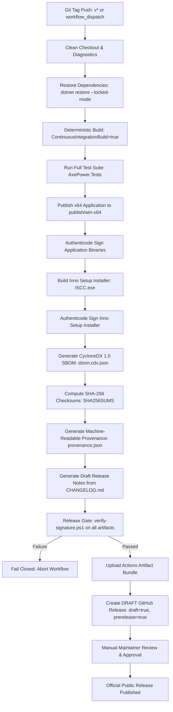

# AxePower Release Candidate Pipeline

## 1. Overview
The AxePower Release Candidate Pipeline automates the compilation, testing, signing, SBOM generation, checksumming, and provenance verification of release artifacts.

To guarantee security and supply-chain integrity:
- **Clean Tagged Builds**: Every candidate release is triggered from an explicit Git tag (e.g. `v2.1.0-rc1` or `v2.1.1`).
- **Deterministic Settings**: Built with `-p:ContinuousIntegrationBuild=true -p:Deterministic=true` and locked dependencies (`dotnet restore --locked-mode`).
- **Verifiable Artifacts**: Generates CycloneDX 1.5 SBOM, SHA-256 checksums, and machine-readable provenance.
- **Fail-Closed Release Gate**: Production releases fail closed if Authenticode signing is missing, invalid, or mismatched.
- **Publication Gate**: Releases are created as **DRAFT** releases only. Final public publication requires explicit maintainer review and manual approval.

---

## 2. Pipeline Architecture



---

## 3. Generated Artifact Manifest

Every release candidate generates the following verifiable bundle in `artifacts/release/`:

| Artifact | Purpose | Standard / Format |
|---|---|---|
| `AxePower-v*-Setup.exe` | Production installer executable | Inno Setup 6, Authenticode Signed |
| `AxePower.exe` | Portable application executable | .NET 8 Win-x64, Authenticode Signed |
| `sbom.cdx.json` | Software Bill of Materials | CycloneDX 1.5 JSON |
| `provenance.json` | Machine-readable build provenance | SLSA-inspired JSON |
| `SHA256SUMS` | Cryptographic digests of all outputs | Standard GNU/BSD sha256 checksum format |
| `release-notes.md` | Release highlights & verification guide | Extracted from `CHANGELOG.md` |

---

## 4. Verification Commands

### Checksum Verification
```powershell
# Verify all release files match the SHA256SUMS file
Get-FileHash -Algorithm SHA256 (Get-ChildItem -Path artifacts/release -Exclude SHA256SUMS,*.md)
```

### Signature Verification
```powershell
# Verify Authenticode on installer and application
pwsh scripts/verify-signature.ps1 -FilePath "artifacts/release/AxePower-v2.1.0-Setup.exe" -ExpectedSubject "Abhimanyu Vishwakarma"
pwsh scripts/verify-signature.ps1 -FilePath "artifacts/release/AxePower.exe" -ExpectedSubject "Abhimanyu Vishwakarma"
```

### Run the Release Gate
```powershell
pwsh scripts/release-gate.ps1 -Artifacts (Get-ChildItem artifacts/release/*.exe).FullName -RequireSigned
```

---

## 5. Local Developer Dry-Run

Developers can run the release packaging pipeline locally without production signing certificates:

```powershell
# Run local release packaging in permissive dev mode
powershell -ExecutionPolicy Bypass -File scripts\package-release.ps1 -Version "2.1.0"
```
In permissive dev mode:
- Dependencies are restored and built deterministically.
- Tests are executed.
- Application and installer are staged.
- CycloneDX SBOM, SHA-256 checksums, provenance, and release notes are generated.
- Unsigned binaries emit a `[SKIP]` notice and allow developers to inspect the output package in `artifacts/release/`.
