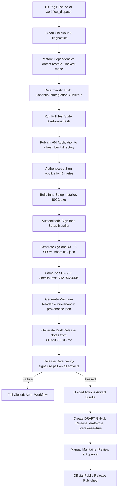

# AxePower Release Candidate Pipeline

## 1. Overview
The AxePower Release Candidate Pipeline automates the compilation, testing, signing, SBOM generation, checksumming, and provenance verification of release artifacts.

To guarantee security and supply-chain integrity:
- **Clean Tagged Builds**: Build a production candidate from a tag such as `v2.1.5` that matches `Directory.Build.props`. The workflow can also be dispatched manually with the declared version.
- **Deterministic Settings**: Built with `-p:ContinuousIntegrationBuild=true -p:Deterministic=true` and locked dependencies (`dotnet restore --locked-mode`).
- **Verifiable Artifacts**: Generates CycloneDX 1.5 SBOM, SHA-256 checksums, and machine-readable provenance.
- **Fail-Closed Release Gate**: Production releases fail closed if Authenticode signing is missing, invalid, or mismatched.
- **Publication Gate**: Releases are created as **DRAFT** releases only. Final public publication requires explicit maintainer review and manual approval.

---

## 2. Pipeline Architecture



---

## 3. Generated Artifact Manifest

Every release candidate generates the following verifiable bundle in `artifacts/release/`:

| Artifact | Purpose | Standard / Format |
|---|---|---|
| `AxePower-v*-Setup.exe` | Production installer executable | Inno Setup 6, Authenticode Signed |
| `AxePower.exe` | Application executable in the Windows x64 publish directory | .NET 10 Desktop Runtime, framework-dependent, Authenticode signed for production |
| `sbom.cdx.json` | Software Bill of Materials | CycloneDX 1.5 JSON |
| `provenance.json` | Machine-readable build provenance | SLSA-inspired JSON |
| `SHA256SUMS` | Cryptographic digests of all outputs | Standard GNU/BSD sha256 checksum format |
| `release-notes.md` | Release highlights & verification guide | Extracted from `CHANGELOG.md` |

---

## 4. Verification Commands

### Checksum Verification
```powershell
# Verify all release files match the SHA256SUMS file
Get-FileHash -Algorithm SHA256 (Get-ChildItem -Path artifacts/release -Exclude SHA256SUMS,*.md)
```

### Signature Verification
```powershell
# Verify Authenticode on installer and application
pwsh scripts/verify-signature.ps1 -FilePath "artifacts/release/AxePower-v2.1.5-Setup.exe" -ExpectedSubject "Abhimanyu Vishwakarma"
pwsh scripts/verify-signature.ps1 -FilePath "artifacts/release/AxePower.exe" -ExpectedSubject "Abhimanyu Vishwakarma"
```

### Run the Release Gate
```powershell
pwsh scripts/release-gate.ps1 -Artifacts (Get-ChildItem artifacts/release/*.exe).FullName -RequireSigned
```

---

## 5. Local Developer Dry-Run

Install the [.NET 10 SDK](https://dotnet.microsoft.com/download/dotnet/10.0) and [Inno Setup 6](https://jrsoftware.org/isinfo.php) to run the release packaging pipeline locally:

```powershell
# Run local packaging using the checkout's declared version
powershell -ExecutionPolicy Bypass -File scripts\package-release.ps1
```
In permissive dev mode:
- Dependencies are restored and built deterministically.
- Tests are executed.
- The script publishes the x64 application to a fresh directory under `build/release-publish/` and passes that path to Inno Setup. The validated installer from `artifacts/release/` is copied to `Installer/Output/`.
- CycloneDX SBOM, SHA-256 checksums, provenance, and release notes are generated.
- Unsigned binaries emit a `[SKIP]` notice and allow developers to inspect the output package in `artifacts/release/`.

To rebuild the same version, archive the existing installer copy and pass a fresh path with `-OutputDir`. The script rejects existing installers or nonempty output directories to protect earlier builds. Keep generated outputs local.
