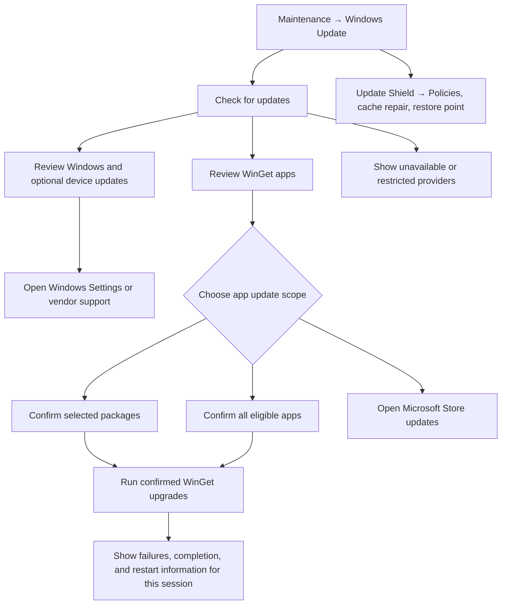

# AxePower Windows Update plan

## Primary goal

Give users one place to see available Windows, app, and supported device updates, choose what to install, and see what succeeded, failed, or still needs a restart. Keep Windows Update settings and repair tools accessible from the same page.

The v2.1.5 source includes separate catalog results, two confirmed WinGet upgrade modes, session results, Windows and vendor handoffs, and Update Shield. The sections below also cover future work, including direct Windows patch installation, Lenovo catalog integration, and persistent update history.

## Compatibility contract

Aim for a usable Windows Update page on every supported AxePower desktop configuration. Evaluate app launch, scan, and install separately. A user can still use the available parts of the page when their account, device, or organization limits a provider.

| User or system | What to support and verify |
| --- | --- |
| Windows 11 x64 on Intel or AMD | Primary desktop target. Test Home and Pro, with Enterprise or Education in the managed-device cohort. The v2.1.5 build is framework-dependent `win-x64` and uses the .NET 10 Desktop Runtime. [Release script](../../scripts/package-release.ps1) · [Installer](../../Installer/AxePower.iss) |
| Windows 10 x64 | The app source declares a Windows API floor of build 17763. Setup behavior, Microsoft support for the OS and runtime, and the feature's capabilities each need checking. Verify launch, discovery, and installation separately on the Windows editions covered. Microsoft servicing depends on edition, servicing channel, or Extended Security Updates enrollment. [README requirements](../../README.md#prerequisites) · [Microsoft lifecycle](https://learn.microsoft.com/en-us/lifecycle/faq/windows) |
| Windows 11 on Arm | The current installer uses `x64compatible`, which can admit Arm64 Windows 11 through x64 emulation. Validate setup, launch, scan and handoffs on Arm64 before listing it as supported. Gate direct device installs by native OS architecture, model, and a verified package. Native Arm64 requires a separate publish, installer, and dependency verification. [Installer architecture](../../Installer/AxePower.iss#L33) · [Inno Setup architecture identifiers](https://jrsoftware.org/inno-setup/documentation/topic_archidentifiers.htm) · [Microsoft Arm support](https://learn.microsoft.com/en-us/windows/arm/add-arm-support) |
| Windows x86, Windows 10 on Arm, macOS, Linux, Windows Server, and S mode | The current Windows desktop release packages x64 only. Windows 10 on Arm provides x86 emulation. Windows Server is outside the desktop release matrix, and S mode requires compatible Microsoft Store distribution. Publish these boundaries alongside the download. [Microsoft emulation support](https://learn.microsoft.com/en-us/windows/arm/apps-on-arm-x86-emulation) · [Microsoft S mode requirements](https://support.microsoft.com/en-us/windows/experience/platform-variants/windows-10-and-windows-11-in-s-mode-faq) |
| Standard user, local account, or signed out of AxePower | Scanning where permitted, review, and system/vendor handoffs must work without an AxePower account or mandatory elevation. The current desktop manifest is `asInvoker`, the app can request elevation at startup, and the standard installer requires admin. Verify a policy-approved installation path for users without credentials and confirm the installed app remains usable when elevation is denied or cancelled. [Manifest](../../AxePower.App/app.manifest#L9) · [Startup check](../../AxePower.App/App.xaml.cs#L253) · [Installer privileges](../../Installer/AxePower.iss#L33) |
| Work/school PC, child or restricted account, or shared PC | Respect local policy, MDM/Group Policy, Windows Update sources, and application restrictions. Keep the scan and approved WinGet execution in the same signed-in user context, including when an administrator from another account approves a protected action. Show available actions and an organization or Settings handoff when authority is unavailable. [Windows Update access rules](https://learn.microsoft.com/en-us/windows/win32/wua_sdk/secured-methods-and-properties-in-the-wua-api) |
| WinGet or Store absent, offline, metered, or update service blocked | Detect each provider and capability separately. Show whether results are unavailable, restricted, or from a previous scan. Offer Windows Settings, a permitted App Installer/Store route if available, or an administrator handoff. Respect metered connections before downloading. WinGet availability depends on App Installer and user registration. [Microsoft WinGet requirements](https://learn.microsoft.com/en-us/windows/package-manager/winget/#install-winget) |
| Lenovo, another vendor, custom-built PCs, and VMs | Windows and app providers work independently of OEM detection. Lenovo-specific installs require verified Lenovo models and packages. Use existing graphics and official vendor actions for other brands where applicable. Render unavailable hardware details as such, including on a VM. |
| Keyboard, screen reader, high contrast, larger text, and display-language changes | Every core action, selection, confirmation, progress update, error, and restart choice must be operable and understandable. Keep status labels independent of CLI output language and color. Test non-English inventory, long text and high DPI, and announce state changes without moving focus. [AxePower accessibility matrix](ACCESSIBILITY.md) |

Use OS build and edition, **OS architecture** and process architecture, current user and elevation, hardware identity, policy and provider availability to decide which actions to expose. Record results by action and configuration. A successful app launch establishes launch coverage. Direct install, cache repair, and restart-policy support each require their own evidence.

**Runtime prerequisite.** Setup uses the x64 .NET Desktop Runtime 10.0.15 or a newer 10.0.x patch. The runtime support table and Windows servicing lifecycle both apply. Use the actual setup and app artifacts for each compatibility check. [Runtime bootstrap](../security/RUNTIME_BOOTSTRAP.md) · [Microsoft .NET lifecycle](https://dotnet.microsoft.com/en-us/platform/support/policy/dotnet-core) · [Supported Windows versions](https://learn.microsoft.com/en-us/dotnet/core/install/windows#supported-versions)

**Release validation.** Automated tests cover simulated update operations and page behavior. Setup coverage across Windows versions, Arm64 hardware, managed devices, and vendor-specific tools requires the corresponding environment checks in Phase 6.

## Update flow in v2.1.5



## Phase 0 — Documentation discovery and current behavior

**How this serves the primary goal.** It identifies which update actions AxePower can verify and where the user needs a Windows or vendor handoff.

| Reference | How AxePower will use it |
| --- | --- |
| [PSWindowsUpdate examples](https://github.com/mgajda83/PSWindowsUpdate#usage-and-examples) · [Published module](https://www.powershellgallery.com/packages/PSWindowsUpdate/2.2.1.5) | Model a separate scan and install, exact update identity and revision, history, and restart state. Implement those behaviors through Microsoft's Windows Update Agent (WUA). |
| [WindowsUpdateEverythingSilent update and reboot steps](https://github.com/murilogiatti/WindowsUpdateEverythingSilent/blob/main/CleanupAndUpdateEverything.ps1#L63-L99) | Adopt a single progress view, distinct Windows and app stages, a Microsoft Store handoff, and a final restart decision. Express those as structured results in AxePower. |
| [WinUtil update profiles](https://github.com/ChrisTitusTech/winutil/blob/main/docs/src/content/docs/guides/updates.mdx) · [Policy tests](https://github.com/ChrisTitusTech/winutil/blob/main/pester/update-profiles.Tests.ps1) · [Repair source](https://github.com/ChrisTitusTech/winutil/blob/main/functions/public/Invoke-WPFFixesUpdate.ps1) | Use named settings, previewable changes, restore-to-prior behavior, and staged repair diagnostics. Keep AxePower's repair scoped to the download cache. |
| [LSUClient](https://github.com/jantari/LSUClient) · [Install results](https://github.com/jantari/LSUClient/blob/master/public/Install-LSUpdate.ps1#L108-L159) | Use the Lenovo-only catalog for model-aware discovery and staged driver updates. Keep firmware in a separate review with vendor handoff. |
| [Windater stage dispatcher](https://github.com/Qv1ko/Windater/blob/master/windater.ps1#L116-L129) · [Repository status](https://github.com/Qv1ko/Windater) | Apply its provider-availability and staged execution ideas to a run that can report independent failures. The upstream repository is archived and has no visible license. Use it as a design reference. |
| [Microsoft WinGet upgrade reference](https://learn.microsoft.com/en-us/windows/package-manager/winget/upgrade) · [Pinning rules](https://learn.microsoft.com/en-us/windows/package-manager/winget/pinning) | Preserve the supplied WinGet command as an explicit bulk mode. Use exact package targeting for individually selected upgrades. |

Current entry points

- The [sidebar](../../AxePower.App/Views/Shell/ShellSidebar.xaml), [tray](../../AxePower.App/MainWindow.xaml), and tool guide open the Updates overview through the shared navigation. [MainViewModel](../../AxePower.App/ViewModels/MainViewModel.cs)
- **Check for updates** combines separately reported Windows catalog, WinGet, and firmware checks. **Last checked** is derived from the check result. [Update page view model](../../AxePower.App/ViewModels/SoftwareHubViewModel.PcUpdates.cs)
- The overview uses expandable groups that start collapsed at every width. Resizing preserves app selections and each group’s expanded state. [Updates overview view](../../AxePower.App/Views/SoftwareHub/UpdatersTab.xaml)
- **Update selected apps** uses exact WinGet targets. **Update all eligible apps** keeps `--include-unknown` available as an explicit opt-in, and the page asks for confirmation in either mode. [WinGet update service](../../AxePower.Core/Services/SoftwareHub/WinGetUpdateService.cs)
- Update Shield retains the policy controls, guarded cache repair, and the restore point action. Policy behavior depends on the Windows version, edition, user privileges, and effective management policy. [Update Shield service](../../AxePower.Core/Services/WindowsUpdateShieldService.cs)

Documented integration APIs

- **Windows.** Use `Microsoft.Update.Session`, `IUpdateSearcher.Search`, `IUpdate.Identity`, `IUpdate.Categories`, `IUpdate.BundledUpdates`, `IUpdateDownloader`, `IUpdateInstaller`, `IInstallationResult.GetUpdateResult`, and `ISystemInformation.RebootRequired`. Microsoft documents that direct WUA installs use a workflow separate from Windows Settings history and can conflict with the Windows Update Orchestrator. [Search and install example](https://learn.microsoft.com/en-us/windows/win32/wua_sdk/searching--downloading--and-installing-updates#example) · [Update metadata](https://learn.microsoft.com/en-us/windows/win32/api/wuapi/nn-wuapi-iupdate) · [Installation results](https://learn.microsoft.com/en-us/windows/win32/api/wuapi/nn-wuapi-iinstallationresult) · [WUA overview](https://learn.microsoft.com/en-us/windows/win32/wua_sdk/portal-client)
- **Handoffs.** Use fixed `ms-settings:windowsupdate`, `ms-settings:windowsupdate-optionalupdates`, `ms-settings:windowsupdate-restartoptions`, and `ms-windows-store://downloadsandupdates` targets. Record the launch outcome. [Windows Settings URIs](https://learn.microsoft.com/en-us/windows/apps/develop/launch/launch-settings) · [Microsoft Store URIs](https://learn.microsoft.com/en-us/windows/apps/develop/launch/launch-store-app)
- **Apps and Lenovo.** Use documented WinGet list, upgrade and pin behavior. Use `Get-LSUpdate`, `Save-LSUpdate`, and `Install-LSUpdate` with per-package results. [WinGet list options](https://learn.microsoft.com/en-us/windows/package-manager/winget/list) · [LSUClient cmdlets](https://jantari.github.io/LSUClient-docs/docs/cmdlets/get-lsupdate/) · [LSUClient staging](https://jantari.github.io/LSUClient-docs/docs/topics/best-practices/#2-download-all-packages-before-starting-to-install-any)

**Completion check.** The referenced source and contracts are identified. Live catalog classification, WinGet discovery across versions, direct WUA coexistence, and Lenovo hardware behavior still need the release validation in Phase 6.

## Phase 1 — Real scan and install review

**How this serves the primary goal.** Every Update PC entry point leads to the same review, and the page can tell a successful scan from an unavailable provider.

1. Make the sidebar, tray, and guide open the same **Updates overview**. Replace the legacy “Launch updater” action with **Check for updates**. Keep **Gaming Runtimes & Tools** and **Update Shield** reachable and preserve tab/category deep links. Start in the existing [Software Hub](../../AxePower.App/Views/SoftwareHubView.xaml#L34), [Updaters tab](../../AxePower.App/Views/SoftwareHub/UpdatersTab.xaml#L52), and [navigation](../../AxePower.App/ViewModels/MainViewModel.cs#L454).
2. Give Windows, Apps, and Device providers a shared item and outcome shape. Store provider identity, title, installed/target version or KB where available, selection eligibility, and scan time. Distinguish pending, current, unavailable, blocked, and failed. Allow other providers to return results when one fails. Display **Last checked** only from completed scans and **Last installed** from verified install history. Show scheduling only when backed by an actual schedule.
3. Present per-item review and one confirmation for the selected run. Request elevation only when a chosen action requires it. Revalidate the reviewed identities, account context, and scope immediately before mutation. Return to review for materially changed selections. Reuse [ConfirmationCatalog](../../AxePower.Core/Services/Operations/ConfirmationCatalog.cs) and [OutcomeClassifier](../../AxePower.Core/Services/Outcomes/Outcomes.cs#L94) for confirmation and feedback.
4. Queue approved stages serially, run only one apply or Shield repair at a time, and keep per-item progress visible during navigation. If a stage encounters a blocker or pending restart that makes the next stage unsafe, pause the queue and preserve the completed outcomes. Record interrupted runs, stop before the next stage on cancellation, and re-scan before retrying. Never treat cancellation as rollback. Use the local, bounded, atomic history pattern in [OperationJournal](../../AxePower.Core/Services/Operations/OperationJournal.cs#L14).

**Verify.** Sidebar, tray, and guide reach review without launching an installer. Scan with one failed provider, stale selection, double-click, declined UAC, cancellation, and app exit are all represented honestly. Earlier successes remain visible after a partial or interrupted run.

**Guard.** A provider's launch, empty result, or unknown state cannot be converted into a successful installation, a complete scan, or an invented next update time.

## Phase 2 — Windows patches and Microsoft Store handoff

**How this serves the primary goal.** Users can see which Windows updates were found, review the eligible patch set, and know which patches actually installed.

1. Add a WUA-backed Windows scan that honors the device's existing update source and policy. Read availability, stable GUID and revision, KB, catalog categories, and supported metadata. Keep driver and optional discovery separate from ordinary non-hidden, uninstalled software updates.
2. Preselect only positively identified, non-optional Windows security and critical patches on the validated path. Use category IDs and known product metadata, inspect bundled children, and keep optional previews, feature upgrades, drivers, firmware, and ambiguous items outside the recommended set. Show applicable items requiring Windows Settings under **Open Windows Update** or **Optional updates**. Surface required update agreements from WUA before accepting them for the confirmed selection.
3. Put direct WUA install behind a compatibility gate. Where enabled, rebuild the approved collection by identity and revision, check for busy or pending-restart states, download, install only successfully downloaded and still applicable items, and capture per-item result codes, HRESULTs, and reboot flags. Use asynchronous WUA job semantics where needed. If coexisting with Windows orchestration is unreliable, or policy blocks the operation, route the user to Settings. Keep Windows orchestration and the configured update source active. [Search criteria](https://learn.microsoft.com/en-us/windows/win32/api/wuapi/nf-wuapi-iupdatesearcher-search) · [WUA access rules](https://learn.microsoft.com/en-us/windows/win32/wua_sdk/secured-methods-and-properties-in-the-wua-api) · [Async guidance](https://learn.microsoft.com/en-us/windows/win32/wua_sdk/guidelines-for-asynchronous-wua-operations)
4. Retire the old elevated PowerShell batch only after the overview and its replacement actions are wired. Add **Open Microsoft Store updates** using the fixed documented URI via [UserShellLauncher](../../AxePower.Core/Services/Processes/UserShellLauncher.cs#L75). Add a narrow, fixed-target route for Windows Settings using the same standard-user launch pattern. Save AxePower's confirmed outcomes in its own history and use provider/native history for reconciliation when available.

**Verify.** Test stable and preview patches, optional updates, feature upgrades, firmware/driver bundles, managed and offline machines, Windows Update already running, a declined agreement, partial download/install, and pending restart. Validate the Settings and Store targets on supported builds.

**Guard.** `Type='Software'` alone does not identify a security update. A dispatched scan or Store launch provides no evidence of completion. Direct installation stays gated wherever validation fails.

## Phase 3 — WinGet preview, selected upgrades, and explicit bulk mode

**How this serves the primary goal.** Users can update reviewed apps individually or deliberately run the requested all-app upgrade.

1. Use `winget upgrade` for the initial preview or `winget list --upgrade-available` where supported. Keep WinGet version and capability detection separate from parsed inventory. Validate discovery against localization, missing App Installer, unavailable sources, and user versus machine scope. If exact package identity, source, or target is uncertain, offer a clearly labeled bulk or WinGet handoff and omit exact-selection claims. Prototype structured discovery only if the CLI preview cannot meet that contract. [Documented structured WinGet package option](https://github.com/microsoft/winget-cli/blob/master/src/PowerShell/Help/Microsoft.WinGet.Client/Get-WinGetPackage.md)
2. Build the normal **Update selected apps** path with validated IDs, exact matching, the reviewed source, and the reviewed target version when supported and available. Run in the expected signed-in user's context, letting the installer request elevation when needed. Keep pinned apps out of the default selection and identify the case where a normal pin allows a deliberate individual upgrade. Use [InstallPlanner](../../AxePower.Core/Services/SoftwareHub/InstallPlanner.cs#L160) and [AllowListedProcessRunner](../../AxePower.Core/Services/Processes/AllowListedProcessRunner.cs#L23). Extend the existing planner to use the validated source returned by discovery where needed.
3. Add **Upgrade all eligible apps** with an explicit **Include unknown installed versions** option, off by default. When selected and confirmed, call the existing planner for this command. Show that WinGet chooses the eligible set at execution time and that the command accepts package and source agreements. The preview is indicative and can change before execution.

   ```powershell
   winget upgrade --all --include-unknown --accept-package-agreements --accept-source-agreements
   ```

4. Capture exit codes and package results where reliable. Re-scan and reconcile after bulk execution. Report aggregate and unresolved outcomes separately when the CLI cannot prove each app's result. Catch already current, access denied, checksum mismatch, installer busy, timeout, offline, restart required, and partial failure. [WinGet troubleshooting and return codes](https://learn.microsoft.com/en-us/windows/package-manager/winget/troubleshooting)

**Verify.** Assert exact argument vectors, source and version matching, opt-in gating and pin handling. Test a missing WinGet installation, a rejected agreement, local-user and machine scopes, and mixed results. A selected-app run must never invoke the all-app command.

**Guard.** The supplied agreement flags do not make every installer silent. Keep force, pin overrides, and WinGet-controlled reboot out of the normal flow. Native installers may still have their own restart behavior, which must remain visible in the experience.

## Phase 4 — Lenovo and existing graphics/firmware tools

**How this serves the primary goal.** Device owners see updates that match their hardware, with a clear distinction between an app upgrade, a driver, and a firmware change.

1. Reuse the current [graphics and firmware UI](../../AxePower.App/Views/SoftwareHub/UpdatersTab.xaml#L70) for detected adapters and vendor actions. Fix [firmware scan outcomes](../../AxePower.Core/Services/FirmwareUpdateService.cs#L124) so a failed query is reported as unavailable or failed. Treat GPU companion apps as WinGet apps and avoid updating the same package in a separate driver stage.
2. Integrate a pinned, reviewed LSUClient distribution as an optional Lenovo provider. Verify the module version and integrity and add its license notice to [THIRD_PARTY_NOTICES.md](../../THIRD_PARTY_NOTICES.md). Discover only on confirmed supported Lenovo models. Use `Get-LSUpdate -FailUnsupportedDependencies` when verified for the pinned release to exclude updates with unverified applicability. Show unsupported devices and catalog failures clearly.
3. For approved and validated Lenovo driver packages, stage the reviewed collection with `Save-LSUpdate` and pass the exact packages and staging path to `Install-LSUpdate`. Record per-package success, failure reason, exit code, and reboot/shutdown action. Exclude packages with ambiguous identity, type, applicability, unattended behavior, or reboot behavior from batch apply. Start BIOS and firmware with discovery and official vendor handoff, with firmware install outside this rollout. [LSUClient firmware and reboot documentation](https://jantari.github.io/LSUClient-docs/docs/topics/bios-and-firmware/)

**Verify.** Test Lenovo detection and non-Lenovo fallback with fakes, then validate representative supported Lenovo hardware before exposing installation. Verify staging all downloads before a network-driver update, overlapping Windows/Lenovo/GPU candidates, and reboot or shutdown results. Use the vendor handoff where installed packages cannot be matched reliably.

**Guard.** An unattended flag says an installer can run without its wizard. Gate the approved driver path separately on known restart behavior. Resolve overlaps by stable identity or hardware metadata, with user review for ambiguous matches.

## Phase 5 — Accurate Update Shield controls

**How this serves the primary goal.** Users can see which settings are configured, what they can control, and how repair and restore affect their device.

1. Rename **Security Updates Only** to **Defer feature upgrades**. Show the configured deferral and supported scope. Enabling this policy defers feature upgrades where Windows honors it while leaving normal quality updates active. Represent a registry read-back as configured rather than effective. Explain policy conflicts and prefer Windows Settings or managed-device handoff when control is unavailable. [Feature deferral policy](https://learn.microsoft.com/en-us/windows/client-management/mdm/policy-csp-update#deferfeatureupdatesperiodindays)
2. Replace the unconditional **Block Forced Automatic Reboots** wording with **Restart protection** and show applicability. Microsoft's logged-on restart policy applies to scheduled automatic installs with `AUOptions=4`, and a user-scheduled restart can override it. Do not change download/install mode as a side effect. Offer Windows restart settings where protection cannot be established. [Microsoft restart policy](https://learn.microsoft.com/en-us/windows/deployment/update/waas-restart#delay-automatic-restart)
3. Preview policy diffs. Record prior registry state and restore only values AxePower owns if they still match what it applied. Surface subsequent external changes as conflicts and handle legacy values conservatively. Follow [AxePower safe-change guidance](SAFE_CHANGES.md) and the [WinUtil profile regression examples](https://github.com/ChrisTitusTech/winutil/blob/main/pester/update-profiles.Tests.ps1).
4. Keep cache repair confirmed and download-only. Check update activity first, skip clearing if a required running service cannot stop, attempt to restart services AxePower stopped on every exit, and surface restart failures separately. Make restore-point creation optional before approved actions and report Windows System Protection enablement, success, or failure accurately. Reuse [cache repair orchestration](../../AxePower.Core/Services/WindowsUpdateShieldService.cs#L137), [confirmation](../../AxePower.Core/Services/Operations/ConfirmationCatalog.cs#L146), and [RestorePointService](../../AxePower.Core/Services/RestorePointService.cs#L26).

**Verify.** Cover supported and unsupported policies, Group Policy or MDM control, legacy settings, external edits after apply, stop/start failures, history preservation, and a restore-point failure. Cache repair must not start while AxePower applies updates.

**Guard.** System Restore is an optional recovery aid. Some app, update, and device changes have no AxePower rollback. Keep a global disable-updates profile and aggressive repairs outside this rollout.

## Phase 6 — Test, release, and enable providers

**How this serves the primary goal.** Users get a complete scan-to-results workflow whose claims match behavior on supported machines.

1. Build and test the supported-runtime release using [AxePower CI instructions](CI.md). Extend existing [Software Hub tests](../../AxePower.Tests/SoftwareHub), [Shell tests](../../AxePower.Tests/Shell/ShellViewTests.cs), and [Windows Update Shield tests](../../AxePower.Tests/WindowsUpdateShieldTests.cs) with fake providers, a recorded scan result, and deterministic failures. Confirm that no active entry point can start the old catch-all script. Verify no automatic restart, background install, or third-party module download starts on navigation or scan.
2. Run the compatibility matrix against the actual release installer and packaged executable. Include Intel and AMD x64 Windows 11, an advertised Windows 10 x64 cohort with its servicing status recorded, and a separate Windows 11 Arm64 emulation trial. Within those cohorts, cover managed and unmanaged devices, a standard user with no admin credentials, an administrator, elevation using a different account, missing App Installer/Store, non-English Windows, and offline or metered networks. Run scan, review, cancel, apply where allowed, reboot-pending, and interrupted-run cases. Validate LSUClient on representative supported Lenovo hardware and check non-Lenovo behavior separately.
3. Complete a manual keyboard, Narrator, high-contrast, and large-text pass of the update workflow. Publish a per-feature support matrix with build, edition, architecture, account class, result, and fallback. Mark untested combinations separately from confirmed limitations and identify the installer/runtime prerequisites in the release notes. Review [diagnostics](DIAGNOSTICS.md) and [owner checks](OWNER_CHECKS.md) before rollout.
4. Ship the overview, WinGet, handoffs, and corrected Shield first once validated. Enable direct Windows installs per validated configuration with Windows Update Orchestrator active. Keep other configurations on the Settings route. Enable Lenovo driver installation after hardware validation and retain vendor handoff elsewhere.

**Release criteria.** No installs occur before confirmation. Every scan and apply returns a meaningful result. History agrees with actual results or marks uncertainty. Every reboot or shutdown that AxePower initiates requires a separate user action. A supported standard user can reach review and available handoffs without admin credentials or an AxePower sign-in. Every unavailable provider offers a usable reason or handoff. Published support claims and enabled direct installs match the release evidence.
