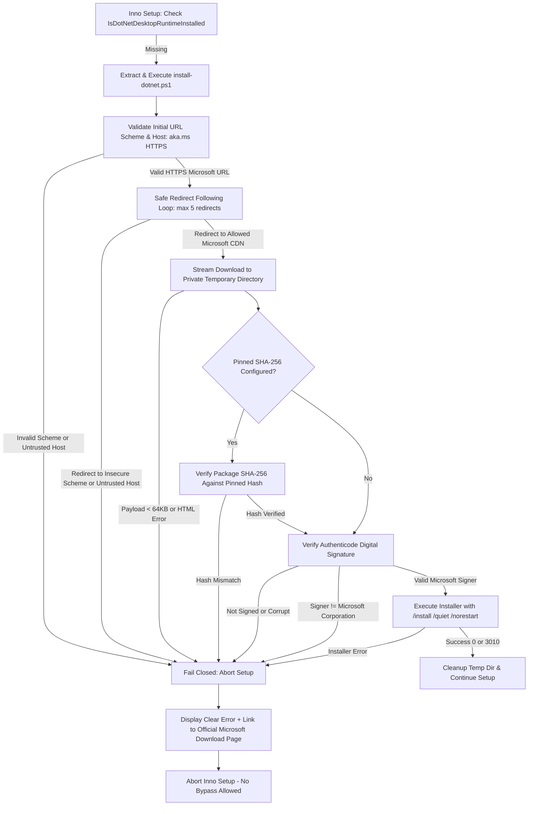

# Hardened .NET Desktop Runtime Bootstrap Architecture

## 1. Overview
AxePower requires the 64-bit Microsoft .NET 8 Desktop Runtime to execute. During installation, if the runtime is not present, AxePower Setup invokes `Installer/install-dotnet.ps1` to acquire and install the prerequisite.

Previously, `install-dotnet.ps1` only inspected whether the downloaded file began with the two ASCII characters `MZ` (DOS header) and used `curl.exe -L` to follow any redirect blindly to a predictable filename in `%TEMP%`. If installation failed, Inno Setup offered a prompt allowing the user to bypass the runtime prerequisite.

This bootstrap path has been completely hardened to prevent arbitrary code execution, open redirect attacks, and unverified package execution.

---

## 2. Hardened Verification Pipeline

---

## 3. Key Hardening Controls

### A. HTTPS-Only & Allowed Microsoft Host Policy
- Enforces `https://` for all connections. Insecure schemes (`http://`, `ftp://`, `file://`) are strictly rejected.
- Redirects are processed manually with automatic redirect following disabled. Each redirect target is validated against the authorized Microsoft domain allow-list before being followed:
  - `aka.ms`
  - `download.visualstudio.microsoft.com`
  - `download.microsoft.com`
  - `dotnetcli.azureedge.net`
  - `dotnetbuilds.azureedge.net`
  - `dotnet.microsoft.com`
  - `dotnetcli.blob.core.windows.net`
- Any redirect to an unauthorized host (e.g., an open redirect or CDN hijacking attempt) is aborted immediately.

### B. Authenticode Signature & Microsoft Publisher Enforcement
- The downloaded installer must be digitally signed and verified using `Get-AuthenticodeSignature`.
- `Status` must be `Valid`.
- The signer certificate subject must match official Microsoft signing identities:
  - `CN=Microsoft Corporation`
  - `O=Microsoft Corporation`
  - `CN=Microsoft Windows`
- Non-Microsoft signatures or unsigned files (even if starting with `MZ`) are rejected.

### C. Optional Pinned Hash Support
- Accepts an optional parameter `-PinnedSha256` (or `$env:DOTNET_RUNTIME_SHA256`).
- When provided, the downloaded package's SHA-256 checksum is computed via `Get-FileHash` and verified prior to signature checking.

### D. Isolated Temporary Directory & Reliable Cleanup
- Staged in a privately generated random directory:
  `%TEMP%\AxePower_DotNet_{guid}\windowsdesktop-runtime-win-x64.exe`
- The entire directory is purged in a `finally` block upon completion, failure, or cancellation.

### E. Elimination of Insecure Bypass in Inno Setup
- In `Installer/AxePower.iss`, if `InstallDotNetRuntime()` fails, the setup displays an error dialog directing the user to the official Microsoft download portal:
  `https://dotnet.microsoft.com/download/dotnet/8.0`
- The previous "Continue installing AxePower anyway?" bypass has been removed. Setup aborts to protect system stability.

---

## 4. Test Verification ([`AxePower.Tests/DotNetBootstrapTests.cs`](file:///d:/Projects/AxePower/AxePower.Tests/DotNetBootstrapTests.cs))

The automated test suite verifies:
1. `HtmlOrErrorPayload_IsRejected`: Rejects HTML CDN error pages or truncated files.
2. `MzOnlyHeaderWithoutAuthenticode_IsRejected`: Proves that a file with an `MZ` header lacking a valid Authenticode signature is refused.
3. `UnexpectedRedirect_IsRejected`: Rejects HTTP 302 redirects to unauthorized domains (`evil.attacker.example.com`).
4. `PinnedHashMismatch_IsRejected`: Fails closed when the package hash does not match `$PinnedSha256`.
5. `FailedDownload_IsRejected`: Detects HTTP 500 / network transport failures cleanly.
6. `ValidMicrosoftSignatureMetadata_IsAcceptedByVerificationLogic`: Confirms that official Microsoft certificate subjects pass the validation rules.
7. `InnoSetupScript_DoesNotOfferBypassOnRuntimeFailure`: Asserts that `AxePower.iss` contains no permissive bypass prompt and aborts setup on missing prerequisites.
