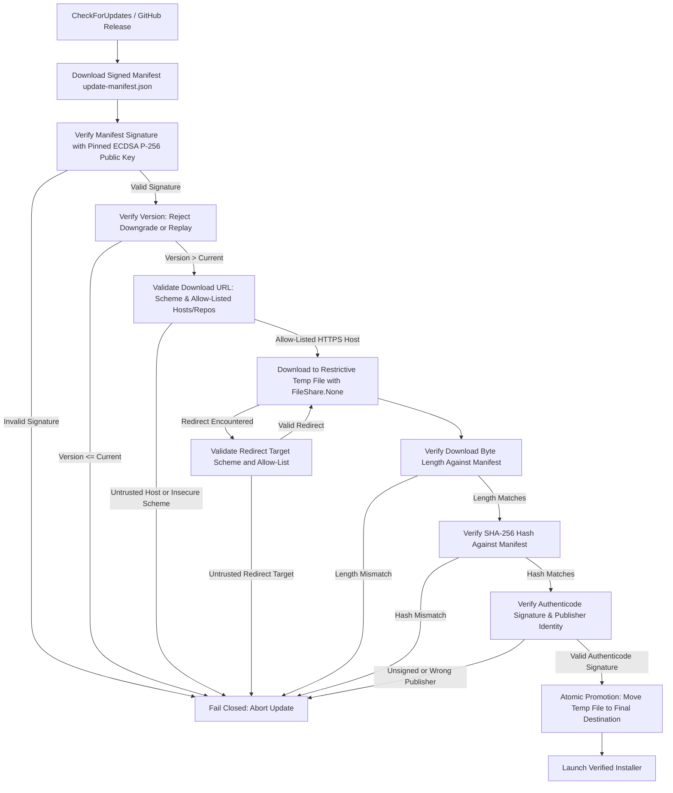

# AxePower Cryptographically Signed Update Architecture

## 1. Overview
Previously, AxePower inspected candidate update downloads by verifying only that the payload started with the two-byte DOS magic header `MZ` (0x4D, 0x5A) and was larger than 64 KB. This was insufficient because an attacker capable of serving malicious files or tampering with downloads could supply an arbitrary unsigned binary beginning with `MZ`.

Under the hardened **Signed Update Architecture**, AxePower enforces a multi-layered cryptographic verification pipeline. No update is downloaded or executed without passing every verification stage.

---

## 2. Security Pipeline & Verification Layers

### Layer 1: Pinned Manifest Cryptographic Signature
- Every release publishes an `update-manifest.json` containing:
  - `version`: Target semantic version.
  - `assetName`: Installer filename (e.g. `AxePower-v2.1.1-Setup.exe`).
  - `byteLength`: Exact payload length in bytes.
  - `sha256`: Lowercase hexadecimal SHA-256 digest of the final signed installer.
  - `signature`: Base64-encoded digital signature computed over canonical UTF-8 bytes:
    `"{version}\n{assetName}\n{byteLength}\n{sha256}"`.
- Verified using NIST P-256 (ECDSA with SHA-256) against the pinned public key.
- If no trusted public key is configured or the signature does not match, the update **fails closed** immediately before downloading the binary payload.

### Layer 2: Downgrade and Replay Prevention
- Before downloading the executable, the target version is compared against `GetCurrentVersion()`.
- If `targetVersion <= currentVersion`, the update is aborted with a security exception.

### Layer 3: HTTPS & Allow-Listed Hosts / Repositories
- Update downloads strictly require `https://`. Insecure schemes (`http://`, `ftp://`, `file://`) are rejected.
- Only allow-listed GitHub hosts are permitted:
  - `github.com`
  - `api.github.com`
  - `objects.githubusercontent.com`
  - `github-releases.githubusercontent.com`
- Repository paths are restricted to:
  - `/mrAbhimanyuVishwakarma/AxePower/`
  - `/mrAbhimanyuVishwakarma/AxePower_Download/`
- **Safe Redirect Handling**: The HTTP client inspects every 301/302/307/308 redirect and verifies the target URL against the allow-list before following. Redirects to untrusted external domains (e.g., open redirect attacks) are aborted.

### Layer 4: Restrictive Temporary Staging & Atomic Promotion
- Downloads are streamed into a unique temporary file (`update_{guid}.tmp`) with `FileShare.None`. No other process can read or tamper with the file in transit.
- Cancellation and stall timeouts automatically clean up any incomplete temporary files.
- Atomic promotion (`File.Move`) occurs only after all cryptographic checks succeed.

### Layer 5: Asset Length & SHA-256 Digest Verification
- Streams through `IncrementalHash.CreateHash(HashAlgorithmName.SHA256)` during download.
- Verifies that received byte count matches `manifest.byteLength`.
- Verifies that computed SHA-256 matches `manifest.sha256`.

### Layer 6: Authenticode & Publisher Identity Verification
- Even with a valid manifest, the downloaded `.exe` must be Authenticode-signed.
- Verified on Windows via `WinVerifyTrust` and `X509Certificate` inspection:
  - Validates that the file has an embedded Authenticode signature.
  - Validates that the certificate subject matches the expected publisher identity (`CN=Abhimanyu Vishwakarma`).
  - Proves the binary was not tampered with post-signing.
- `ApplyUpdate` re-verifies the Authenticode signature before executing the installer.

---

## Owner setup: the update-signing key (2026-10-06)

The pinned key lives in `AxePower.Core/Services/Update/UpdateSigningKey.cs`. Until one is
generated it is empty, and updates fail closed.

**Once:**
1. `powershell -ExecutionPolicy Bypass -File scripts\new-update-signing-key.ps1`
   - creates an ECDSA P-256 key pair with `tools/AxePower.UpdateSigning`;
   - saves the **private** key to `%USERPROFILE%\AxePower-update-signing\update-signing.key.pem`.
     It refuses a path inside the repository, and refuses to overwrite an existing key without `-Force`;
   - pins the **public** key in `UpdateSigningKey.cs`.
2. Back up the private key in a password manager. Losing it means installed copies cannot be
   updated automatically; leaking it lets someone else sign updates.
3. Commit `UpdateSigningKey.cs` and ship a build that contains it. Only copies with the key can
   verify later updates.

**Each release:**
1. Build the installer as usual.
2. `powershell -ExecutionPolicy Bypass -File scripts\sign-update-manifest.ps1 -Installer Installer\Output\AxePower-vX.Y.Z-Setup.exe -Version X.Y.Z`.
   This writes `update-manifest.json` (file name, size, SHA-256, signature). It refuses to write a
   manifest that does not verify with the pinned public key. `scripts/package-release.ps1` calls
   it automatically when the key is present.
3. Upload `update-manifest.json` to the same GitHub release as the installer.

**Unsigned releases.** There is no code-signing certificate yet, so
`UpdateSigningKey.ReleasesAreAuthenticodeSigned` is `false` and Layer 6 is off by default. An
update is accepted only when the manifest verifies with the pinned key (Layer 1) and the
download matches the signed size and SHA-256 (Layer 5). When installers become Authenticode-signed,
set it to `true` to turn Layer 6 back on.

## 3. User-Readable Messages Without Bypass

When any security check fails, AxePower displays an informative explanation and logs the failure:
- *"Update rejected: Proposed version 2.0.0 is not newer than current version 2.1.0. Downgrade and replay attacks are prohibited."*
- *"Update manifest signature verification failed: Cryptographic signature does not match manifest contents or pinned public key."*
- *"SHA-256 hash mismatch! The downloaded update does not match the signed manifest."*
- *"Authenticode signature verification failed: Signer identity does not match expected publisher."*

**No bypass option** (such as "Ignore and install anyway") is offered to the user.

---

## 4. Automated Test Matrix

The test suite in [`AxePower.Tests/UpdateSecurityTests.cs`](file:///d:/Projects/AxePower/AxePower.Tests/UpdateSecurityTests.cs) validates the following scenarios:

| Test Case | Scenario | Expected Outcome |
|---|---|---|
| `TamperedManifest` | Manifest contents altered after signing | Throws `UpdateVerificationException`, download refused |
| `WrongKey` | Manifest signed with untrusted private key | Throws `UpdateVerificationException`, download refused |
| `ChangedInstaller` | Installer payload tampered on wire (hash mismatch) | Throws `UpdateVerificationException`, promotion refused |
| `WrongPublisher` | Installer signed by unauthorized third party | Throws `UpdateVerificationException`, execution refused |
| `UnexpectedRedirect` | Server redirects download to unauthorized host | Throws `UpdateVerificationException`, redirect aborted |
| `DowngradeOrReplay` | Target version <= installed version | Throws `UpdateVerificationException`, download refused |
| `TruncatedFile` | Network connection severed prematurely | Throws `UpdateVerificationException`, partial file deleted |
| `ConcurrentRequests` | Multiple triggers simultaneously request update | Single-flight gate ensures only 1 download occurs |
| `ValidSignedFixture` | Fully valid signed manifest and payload | Download succeeds and promotes installer |
| `MzOnlyHeader` | Unsigned binary with MZ header | Refused by `ApplyUpdate` and verifier |
| `WindowsAuthenticode` | Verified against Windows system signed binaries | Confirms root trust and publisher matching |
