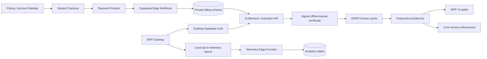

# AxePower Commercialization and Monetization Blueprint

**Prepared:** 2026-10-01  
**Scope:** AxePower desktop application, website, Supabase backend, and mobile prototype

## Executive recommendation

AxePower should not be monetized as a usage-based SaaS today.

The best fit for the current architecture is:

- A free Community tier for acquisition.
- A one-time, account-linked AxePower Pro license for advanced local features.
- Signed offline entitlements for up to three PCs.
- Optional paid major-version upgrades.
- A subscription add-on only after AxePower operates a meaningful cloud service such as TURN relaying, remote access, cloud sync, or managed device fleets.

Almost all expensive work—hardware monitoring, game scanning, audio playback, cleanup, automation, and screen encoding—runs on the customer's PC. Current cloud usage is mainly Supabase authentication, social presence, invitations, and modest database traffic. Charging by usage would be arbitrary, while a subscription would currently be difficult to justify.

A reasonable launch price is **$39 one-time**, with a **$29 founding offer**, three personal devices, and perpetual use of the purchased major version. This is consistent with Process Lasso's $39.95 lifetime option and Revo's roughly $25 license with one year of updates. Razer Cortex remains free, so the core gaming hook must also remain useful for free.

Market references:

- [Process Lasso pricing](https://bitsum.com/get-lasso-pro/)
- [Revo Uninstaller pricing](https://www.revouninstaller.com/products/revo-uninstaller-pro/)
- [Razer Cortex](https://www.razer.com/cortex/booster)

## 1. Feature valuation

| Feature area | Commercial value | Recommendation | Reason |
|---|---:|---|---|
| Manual power modes, dashboard telemetry, basic battery information | High adoption value, low direct willingness to pay | **Free** | These are AxePower's identity and activation hook. The repository calls power modes the core feature in [power-modes.md](skillsMD/power-modes.md). |
| Basic Auto Switch: AC/battery mode switching | High adoption and retention | **Free** | The automatic behavior is central to the product promise. Removing it would make Free feel like a demo. |
| Per-app power rules and Routines | Very high recurring utility | **Pro** | Automation is sticky, differentiated, and costs almost nothing per customer. Routines are not commercially ready until their real-PC verification is complete; see [ROUTINES_PLAN.md](skillsMD/ROUTINES_PLAN.md). |
| Uninstaller Pro | Very high willingness to pay | **Freemium split** | Keep inventory and normal single-app uninstall free. Put batch uninstall, broken-entry recovery, deep leftovers, history, and resumable cleanup in Pro. Never gate the safety backups separately from cleanup. See [uninstaller.md](skillsMD/uninstaller.md). |
| Game Mode | High, but competitive | **Freemium split** | Keep scanning, launching, and manual Game Mode free. Put automatic per-game profiles, service throttling, advanced GPU behavior, and reusable optimization profiles in Pro. |
| Friends and Share Screen | High future value | **Free network, Pro host capabilities** | Accounts, friends, invitations, joining, and basic LAN view-only sharing should be free to preserve network effects. Host-side 1080p60, audio, remote control, multiple viewers, and future internet relay belong in Pro. |
| System Doctor and Optimizer | Medium | **Manual free; automation Pro later** | SFC, DISM, DNS, repair, and essential maintenance are commoditized Windows capabilities. Future scheduled care, policy profiles, fleet reporting, and automatic remediation can be Pro. |
| Music | Medium engagement, weak monetization foundation | **Local playback free; do not monetize YouTube yet** | Local playback adds product breadth. YouTube streaming has unresolved Terms-of-Service risk documented in [MUSIC_FIX_PLAN.md](skillsMD/MUSIC_FIX_PLAN.md), so it should not be a paid-tier promise. |
| Phone Control, LAN Drop, third-party launchers | Low-to-medium | **Free** | Much of the value is orchestration around scrcpy, SpaceDesk, Phone Link, winget, and other third-party tools. Charging directly for those wrappers is commercially and reputationally weak. |
| Future mobile remote control | Very high | **Pro or Cloud add-on** | Once secure pairing and remote access exist, this can become a primary paid feature. The current prototype is not production-ready. |
| Skins | Low standalone, useful bundle value | **Three core skins free; premium collection in Pro** | Useful as a conversion bonus, but insufficient as the main purchase reason. |
| Accounts, security updates, bug fixes | Foundational | **Always free** | Never gate authentication safety, security fixes, signed updates, or vulnerability patches. |

### Recommended packaging

**AxePower Community**

- Manual power modes.
- Basic Auto Switch.
- Dashboard and battery diagnostics.
- Basic Game Mode and library scanning.
- Standard single-app uninstall.
- Manual system repair tools.
- Local music playback.
- LAN Drop and basic sharing.
- Product and security updates.
- Three base skins.

**AxePower Pro**

- Advanced automation and Routines.
- Per-app and per-game profiles.
- Complete Uninstaller Pro workflows.
- Advanced screen-sharing host capabilities.
- Premium skins.
- Future mobile remote access.

The viewer or invited friend should never need Pro; only the host needs the premium entitlement.

## 2. Monetization and licensing strategy

### Primary model: account-linked perpetual license

Offer:

- $39 one-time regular price.
- $29 founding-user price.
- Three active personal PCs.
- Fourteen-day Pro trial.
- Perpetual access to the purchased major version.
- Optional $19–$24 upgrade when the next major version launches.
- Device deactivation and transfer through the account page.

Use the existing Supabase identity rather than making users repeatedly type a license key. A redeemable code can exist for gifts or manual sales, but the normal purchase should attach the license directly to the signed-in user.

### Why not subscription now?

The current Share Screen topology explicitly has no AxePower relay, TURN service, or hosted media infrastructure; see [SHARE_SOCIAL_PLAN.md](skillsMD/SHARE_SOCIAL_PLAN.md). Desktop encoding, media playback, scanning, maintenance, and automation are local. Supabase presence traffic is too small to establish a fair usage meter.

Introduce a subscription only when there is an ongoing hosted benefit, for example:

- Internet remote-access relay.
- Cloud configuration backup and device sync.
- Managed household or business devices.
- Priority support.
- Cloud game/profile intelligence.

A future **AxePower Cloud** add-on could be approximately $2.99/month with included relay bandwidth. Any overage should apply only to relay bandwidth, not ordinary local product use.

### Open-source constraint

The current website promises MIT, no paywalls, and free use in [terms.html](AppWebsite/terms.html) and [index.html](AppWebsite/index.html). Previously distributed MIT copies remain usable and forkable even if future releases change license.

Before monetization:

1. Freeze the current code as the Community edition.
2. Decide whether future Pro modules live in a private/commercial `AxePower.Pro` assembly or under a source-available license.
3. Audit ownership and third-party adaptations before relicensing.
4. Add an explicit root license; currently the principal licensing statement is embedded in `THIRD_PARTY_NOTICES.md`.
5. Update the website, installer, privacy policy, and terms together.

Client-side gates in public MIT source are deterrence, not strong DRM. The durable commercial moat should be official signed releases, trusted updates, support, new Pro modules, and server-backed services.

## 3. Integration blueprint

### Billing backend

Use hosted Checkout rather than collecting payment details in WPF. Stripe Checkout supports one-time `payment` mode and server-side customer reconciliation. Supabase Edge Functions support server-side payment integrations and webhook handling.

References:

- [Stripe Checkout](https://docs.stripe.com/api/checkout/sessions/create)
- [Supabase Edge Functions](https://supabase.com/docs/guides/functions)
- [Stripe webhook signature verification](https://docs.stripe.com/webhooks/signature)
- [Stripe webhook guidance](https://docs.stripe.com/webhooks)

Add a non-exposed `billing` schema containing:

- `billing.skus`
- `billing.licenses`
- `billing.license_features`
- `billing.device_activations`
- `billing.entitlement_overrides`
- `billing.provider_customers`
- `billing.provider_orders`
- `billing.processed_webhook_events`

Do not allow desktop clients to write these tables. The existing `public.devices` table has owner CRUD policies and therefore should not enforce paid seat limits without being hardened. Use the private activation table instead.

Add Edge Functions:

- `create-checkout`: authenticated; maps a server-owned SKU to a provider price.
- `billing-webhook`: public endpoint, but verifies the raw-body provider signature.
- `get-license`: returns the caller's effective license.
- `activate-device`: enforces the device limit and issues a signed certificate.
- `deactivate-device`: frees a seat.
- `redeem-license`: optional gift/reseller-code path.
- `telemetry-ingest`: accepts consented, schema-validated event batches.

Webhook processing must be idempotent using the provider event ID as a primary key.

### Desktop entitlement layer

Add to `AxePower.Core`:

- `Commercial/FeatureId.cs`
- `Commercial/LicenseCertificate.cs`
- `Commercial/EntitlementSnapshot.cs`
- `Commercial/IFeatureAccessService.cs`
- `Commercial/FeatureAccessService.cs`
- `Commercial/LicenseCache.cs`
- `Commercial/DeviceIdentity.cs`
- `Services/Accounts/SupabaseLicensingApi.cs`

Reuse the existing account token path in [AccountService.cs](AxePower.Core/Services/Accounts/AccountService.cs). Store the certificate beside the account session using the DPAPI pattern already implemented in [AccountSessionStore.cs](AxePower.Core/Services/Accounts/AccountSessionStore.cs).

The signed certificate should include:

- User/license ID.
- Product and major version.
- Feature IDs.
- Device public-key hash.
- Issue time.
- Update entitlement.
- Certificate schema version.

Sign it server-side with ECDSA P-256 and embed only the public verification key in the desktop app. Use a random installation key pair, not serial numbers, MAC addresses, or other hardware fingerprinting.

Register these services in [App.xaml.cs](AxePower.App/App.xaml.cs), then enforce access twice:

1. At the ViewModel/navigation layer for upgrade prompts and disabled controls.
2. Inside sensitive Core operations so a command invoked through another UI route cannot bypass the entitlement.

On network failure, use the last valid signed certificate. A perpetual license should not become unusable merely because Supabase is unavailable. Online checks may revoke refunds or chargebacks when connectivity returns.

### Telemetry

AxePower currently promises zero telemetry. Make product analytics explicitly opt-in and separate it from required billing records.

Collect only:

- Random installation ID.
- App version and Windows build.
- Feature ID.
- Success/failure and stable error code.
- Duration bucket.
- Paywall, trial, checkout, and activation funnel events.
- Crash signature if crash reporting is separately enabled.

Never collect by default:

- File paths or names.
- Installed application lists.
- Process/game names.
- Music titles or searches.
- Chat, room links, clipboard contents, or IP addresses.
- Hardware serial numbers.

Queue events locally, batch them periodically, apply exponential backoff, and cap disk usage. Keep raw events briefly—such as 90 days—and retain only aggregates longer.

### Mobile warning

Do not ship the current mobile cloud bridge. The folder is untracked, the app boots with a hard-coded user in [main.dart](AxePower%20Mobile/lib/main.dart), and it joins predictable Realtime topics without a real authenticated pairing model. The documented desktop bridge also remains incomplete; see [REMOTE_PLAY_PLAN.md](skillsMD/REMOTE_PLAY_PLAN.md).

## 4. Prioritized implementation plan

### Phase 0 — Commercial and safety gate

1. Choose the open-core/licensing posture and update legal documents.
2. Decide the YouTube streaming disposition before advertising or charging for Music.
3. Remove the behavior that deletes all non-stock OEM and user power plans in [PowerPlanService.cs](AxePower.Core/Services/PowerPlanService.cs).
4. Code-sign the EXE and installer.
5. Change the updater from an `MZ` header check to Authenticode publisher verification and/or a signed release manifest in [UpdateService.cs](AxePower.Core/Services/UpdateService.cs).
6. Review global exception handling; the UI currently swallows unhandled exceptions in [App.xaml.cs](AxePower.App/App.xaml.cs).
7. Complete real-device validation for Routines, two-PC sharing, music UI, LAN portal, and uninstall recovery.
8. Remove the mobile prototype from release packaging until authenticated pairing exists.
9. Run secret scanning and rotate any credential-shaped values found in auxiliary folders.

### Phase 1 — Commercial domain foundation

10. Define a stable `FeatureId` catalog and a single Community/Pro capability matrix.
11. Implement `FeatureAccessService`, signed certificate validation, DPAPI cache, and device identity.
12. Add unit tests for Free, trial, Pro, offline, expired, revoked, version-ineligible, and device-limit states.
13. Add UI upgrade surfaces and ensure Free workflows remain complete rather than ending in surprise paywalls.

### Phase 2 — Billing and activation

14. Add the private billing schema and RLS/security-definer tests. Follow [Supabase RLS guidance](https://supabase.com/docs/guides/database/postgres/row-level-security).
15. Implement one-time hosted Checkout and the signed, idempotent webhook.
16. Implement account purchase history, three-device activation, deactivation, refund revocation, and gift-code redemption.
17. Add the pricing/account page to the website and a **Manage license** section in the desktop Profile page.
18. Test purchase, failed payment, duplicate webhook, refund, reinstall, device transfer, account deletion, and offline startup end to end.

### Phase 3 — Feature packaging

19. Gate advanced Auto Switch and Routines only after real-PC validation.
20. Split the Uninstaller experience cleanly between standard removal and Pro deep cleanup.
21. Introduce reusable Game Profiles rather than charging for the existing manual Game Mode alone.
22. Make advanced Share Screen host capabilities Pro while keeping viewers and joining free.
23. Move premium-only implementations into a private or separately licensed assembly if meaningful enforcement is required.

### Phase 4 — Telemetry and launch

24. Add an explicit analytics consent screen and privacy-policy revision.
25. Implement the local queue and ingestion endpoint with PII-denial tests.
26. Define launch metrics: activation, seven-day retention, automation usage, cleanup completion, paywall conversion, trial conversion, refund rate, and crash-free sessions.
27. Run a closed founding-user beta at $29.
28. Validate willingness to pay before adding more tiers; launch with only Community and Pro.
29. Add subscriptions only after relay/cloud costs and user demand are measurable.

## Conclusion

The repository has enough differentiated functionality to support a commercial product, especially around automation and safe uninstall workflows. The immediate work is not adding a checkout button—it is making the safety, licensing, update trust, and entitlement boundaries credible enough that customers will pay for the official build.
