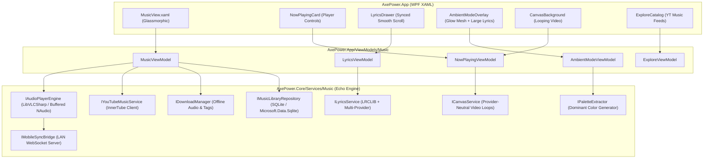

# AxePower Music: Full Functional Replacement Plan (Powered by Echo Music)

> **Document:** `axepower_music.md`  
> **Target Solution:** `D:\Projects\AxePower`  
> **Source Blueprint:** `D:\Projects\Echo-Music`  
> **Status:** Architectural Blueprint & Execution Roadmap  
> **Target Release:** AxePower v2.1+  

---

## 1. Executive Summary

AxePower currently contains a preliminary music player implementation (`AxePower.Core/Services/Music` and `AxePower.App/Views/Music`), but as documented in `skillsMD/MUSIC_FIX_PLAN.md`, the backend has critical gaps: the audio pipeline struggles with YouTube stream expiration, local database scanning was never wired to the UI, discovery returns uncurated queries, and the UI has never been fully exercised.

**Echo Music** is a mature, production-proven Android music client with:
1. **Ad-Free YouTube Music Streaming** via InnerTube (search filters, artist radios, albums, trending charts, mood categories).
2. **Synchronized Lyrics Engine** (multi-provider: LRCLIB, Kugou, BetterLyrics, Paxsenix with millisecond timestamps).
3. **Ambient Mode Visuals** (immersive animated color-glow background dynamically extracted from album art with smooth lyric scrolling).
4. **Canvas Video Backgrounds** (optional provider-neutral looping visuals).
5. **Offline Downloads & Media Caching** (storing audio + high-resolution artwork + ID3 metadata).
6. **Cross-Device Mobile Sync Readiness** (WebSocket/REST state sync architecture designed to link with AxePower Mobile).

### The Objective
Perform a complete functional transplant: **replace the internal playback and content engine of AxePower with the feature set and logic of Echo Music**, while retaining and enhancing AxePower’s signature **dark glassmorphic WPF desktop UI** (`MusicView.xaml`), and adding an **immersive Ambient Mode** and **Mobile Sync Bridge**.

---

## 2. Gap Analysis: AxePower Current vs. Echo Music Target

| Capability | AxePower (Current) | Echo Music (Target) | What Needs to Change in AxePower |
| :--- | :--- | :--- | :--- |
| **Catalog & Search** | Basic keyword YouTube query via raw `YoutubeExplode` | Rich YouTube Music catalog (Albums, Singles, Artists, Playlists, Related Tracks) | Implement full InnerTube API wrapper (or extended YoutubeExplode catalog service) with search filters. |
| **Playback Engine** | Fragile `NAudio.Wasapi` streaming (issues with YouTube cipher/stream expiry) | Robust stream buffering, seamless transitions, crossfade | Upgrade to **LibVLCSharp** (or a resilient buffered NAudio pipeline) with automatic token refresh. |
| **Lyrics** | Non-existent / placeholder | Real-time synchronized lyrics (LRCLIB, Kugou, Paxsenix) with smooth scrolling | Build `LyricsEngine` with `.lrc` timestamp parser and auto-scrolling WPF lyrics panel. |
| **Ambient Mode** | None | Full-screen glowing mesh gradients sampled from album colors + floating synced lyrics | Add **Ambient Theater Mode** with dynamic palette extraction and animated blurred gradients. |
| **Visual Aesthetics** | Static album art inside glass card | Dynamic, provider-neutral Canvas video loops + blurred backdrop | Add looping Canvas video player (`MediaElement` or `LibVLCSharp`) behind the Now Playing card. |
| **Source Scope** | Multiple partially implemented integrations | YouTube Music streaming plus local music only | Keep the provider registry deliberately limited to the local-file and YouTube Music providers. |
| **Mobile App Sync** | Basic unverified LAN remote | Real-time synchronized playback (state, queue, remote controls) | Build future-ready `IMobileSyncBridge` (WebSocket/REST) ready for AxePower Mobile. |
| **Offline Library** | Synchronous TagLib scan on UI thread (blocks app) | Background SQLite indexed library with offline track caching | Migrate to background SQLite repository with real-time file watcher & download queue. |

---

## 3. System Architecture & Component Mapping



---

## 4. Detailed Component Specifications

### 4.1 Audio Engine (`IAudioPlayerEngine`)
- **Problem in current AxePower:** YouTube signed URLs expire after ~1 hour. If paused or queued, tracks throw 403 errors on playback.
- **Echo Solution:** Lazy stream resolution. Streams are resolved only 2-3 seconds before playing. If a stream 403s, the resolver re-fetches a fresh playback manifest automatically.
- **Recommended Tech Stack:** **LibVLCSharp** (`VideoLAN.LibVLC.Windows` & `LibVLCSharp.WPF`).
  - Native support for direct HTTP streaming.
  - Hardware acceleration for video canvas loops.
  - Zero stutter during high CPU gaming loads.

```csharp
public interface IEchoAudioEngine : IDisposable
{
    PlaybackState State { get; }
    TimeSpan Position { get; }
    TimeSpan Duration { get; }
    float Volume { get; set; }
    bool IsMuted { get; set; }

    event EventHandler<PlaybackState>? StateChanged;
    event EventHandler<TimeSpan>? PositionChanged;
    event EventHandler? TrackEnded;

    Task PlayStreamAsync(string streamUrl, TimeSpan startAt = default);
    Task PlayFileAsync(string localFilePath, TimeSpan startAt = default);
    Task PauseAsync();
    Task ResumeAsync();
    Task SeekAsync(TimeSpan target);
    Task StopAsync();
}
```

---

### 4.2 YouTube Music & InnerTube Service (`IYouTubeMusicService`)
Echo Music uses InnerTube to retrieve rich metadata without requiring Google API keys.
- **Search Categories:** Songs, Videos, Albums, Artists, Playlists.
- **Radio & Discovery:** Given any song ID, query `music.youtube.com/youtubei/v1/next` to retrieve an endless mix of musically similar tracks (replaces AxePower's naive keyword guessing).
- **Home / Explore Feed:** Fetches trending charts and curated mood playlists.

```csharp
public interface IYouTubeMusicService
{
    Task<IReadOnlyList<MusicTrack>> SearchAsync(string query, SearchFilter filter = SearchFilter.All, CancellationToken ct = default);
    Task<IReadOnlyList<MusicTrack>> GetRadioMixAsync(string videoId, CancellationToken ct = default);
    Task<MusicAlbumDetails> GetAlbumDetailsAsync(string browseId, CancellationToken ct = default);
    Task<MusicArtistDetails> GetArtistDetailsAsync(string browseId, CancellationToken ct = default);
    Task<StreamManifest> GetPlaybackStreamAsync(string videoId, CancellationToken ct = default);
}
```

---

### 4.3 Synchronized Lyrics Engine (`ILyricsService`)
Ported from Echo Music's `:lrclib`, `:kugou`, and `:betterlyrics` modules:
1. Primary provider: **LRCLIB** (`https://lrclib.net/api/get`).
2. Fallback provider: Kugou / NetEase Cloud Music for tracks not found on LRCLIB.
3. **LRC Parser:**
   - Parses timestamp headers: `[mm:ss.xx] Lyric text`.
   - Supports syllable/word-by-word timestamps (`<mm:ss.xx>`).
   - Generates an `ObservableCollection<LyricLine>` updated via high-precision dispatch.

```csharp
public record LyricLine(TimeSpan Timestamp, string Text, bool IsActive);

public interface ILyricsService
{
    Task<LyricsResult?> GetLyricsAsync(string trackTitle, string artist, string album, TimeSpan duration, CancellationToken ct = default);
}
```

---

### 4.4 Ambient Mode & Dynamic Color Glow (`IPaletteExtractor` & `AmbientModeOverlay`)
Echo Music features an iconic Apple/Material style ambient player where the background glows with colors sampled directly from the album artwork.
- **Palette Extraction:** Downsamples the album cover to a 16x16 grid, extracts the top 2-3 vibrant complementary dominant colors (avoiding pure black or pure white).
- **Ambient Canvas:** In WPF, renders a full-window or card-level animated multi-stop `RadialGradientBrush` with a high Gaussian blur (`BlurEffect Radius="60"`).
- **Lyric Integration:** Lyrics appear in large, high-legibility typography centered over or adjacent to the ambient glow, with the active line glowing softly and inactive lines dimmed to 40% opacity.
- **Theater/Full-Screen Toggle:** A dedicated Ambient Mode button (or `F11` shortcut) shifts AxePower into a distraction-free, cinematic music experience.

```csharp
public interface IPaletteExtractor
{
    /// <summary>Extracts vibrant primary, secondary, and accent colors from an image stream or URI.</summary>
    Task<AlbumPalette> ExtractPaletteAsync(string imageUriOrPath, CancellationToken ct = default);
}

public record AlbumPalette(Color Primary, Color Secondary, Color BackgroundGlow);
```

---

### 4.5 Canvas Video Loop Engine (`ICanvasService`)
Canvas loops can turn static album art into high-impact visuals without coupling AxePower to another catalog.
- Resolve an optional loop URL from YouTube Music metadata or a provider-neutral asset source.
- Stream or cache `.mp4` loop (typically 3-8 seconds, 720p, no audio).
- In AxePower's `NowPlayingCard` or `AmbientModeOverlay`, render the loop with subtle opacity beneath playback controls using WPF `MediaElement` or `VideoLAN.LibVLC.WPF.VideoView`.

---

### 4.6 AxePower Mobile Sync Bridge (`IMobileSyncBridge`)
To prepare for direct pairing and synchronization with the upcoming **AxePower Mobile** app:
- AxePower Desktop acts as the primary hub hosting a secure local WebSocket / HTTP event stream (`ws://<local-ip>:8899/ws/music` or `/api/music/sync`).
- **Real-Time State Broadcast:** Whenever playback state changes (track change, pause, seek, volume, queue change), Desktop broadcasts a JSON state event to connected mobile clients.
- **Remote Control & Queue Push:** AxePower Mobile can send commands (`play`, `pause`, `seek`, `add_to_queue`, `sync_library`) to seamlessly control desktop playback.
- **Architecture is decoupled:** The desktop implementation runs fully standalone now, with the sync endpoints ready to connect instantly when the mobile app is completed.

```csharp
public interface IMobileSyncBridge : IDisposable
{
    void Start(int port = 8899);
    void Stop();
    Task BroadcastStateAsync(PlayerState state);
    event EventHandler<MobileMusicCommandEventArgs>? CommandReceived;
}
```

---

### 4.8 Offline Download Manager (`IDownloadManager`)
- Allow one-click download for songs, albums, and playlists.
- Saves audio stream as high-quality AAC/M4A or Opus.
- Automatically writes standard ID3/Vorbis tags via `TagLibSharp`:
  - Title, Artist, Album, Year, Track Number.
  - High-res embedded cover artwork.
  - Embedded synchronized or plain lyrics.
- Tracks are indexed directly into AxePower's local SQLite library.

---

## 5. UI Layout & Visual Design (AxePower Glassmorphic)

AxePower’s current `MusicView.xaml` already features:
- Deep acrylic/mica glass styling with subtle borders (`#14FFFFFF` gradient).
- Pinned transport bar that never scrolls away.
- Segoe MDL2 icon typography.

### Modified 3-Column Layout with Ambient Mode Toggle:
```text
+---------------------------------------------------------------------------------------------------+
|  [Header] Music          [Search YouTube Music / Ambient Mode]                 [= Queue / Lyrics] |
+------------------------------------+--------------------------------+-----------------------------+
|  Column 1: Library & Explore       |  Column 2: Now Playing & Art   |  Column 3: Synced Lyrics    |
|  - Tabs: Explore / Local / Playlists|  - Large Artwork or Video      |  - Auto-scrolling lyrics    |
|  - Trending & Mood Feeds           |    Canvas Loop (Subtle Motion) |  - Click line to seek       |
|  - Search Result Cards             |  - Glass Transport Bar         |  - Romanization / Translate |
|  - Double click to play            |  - Progress Bar, Time, Volume  |  - Full Queue Tab Switch    |
+------------------------------------+--------------------------------+-----------------------------+
```

### Ambient Theater Mode (Full Window / Expanded):
```text
+---------------------------------------------------------------------------------------------------+
|  [Exit Ambient]                                                          [Cast to Mobile Icon]   |
|                                                                                                   |
|           +---------------------+          "And I know that we're both afraid..."                 |
|           |                     |                                                                 |
|           |   ALBUM COVER ART   |         >>> "BUT WE'RE REACHING FOR THE STARS" <<< (Active Glow)|
|           |    (Or Canvas MP4)  |                                                                 |
|           |                     |          "Through the static and the pouring rain..."           |
|           +---------------------+                                                                 |
|               Song - Artist                                                                       |
|                                                                                                   |
|           [ <<< ]    [ > / || ]    [ >>> ]  ==========O==================== 02:14 / 03:45        |
|                                                                                                   |
|   ~~~~~~~~~~~~~~~~~ DYNAMIC BLURRED COLOR GLOW BACKGROUND (GPU MESH) ~~~~~~~~~~~~~~~~~~~~~~~~~~   |
+---------------------------------------------------------------------------------------------------+
```

---

## 6. Implementation Checklist & Migration Steps

### Phase 1: Engine Foundation
- [ ] Add `LibVLCSharp` & `LibVLCSharp.WPF` (or configure resilient `NAudio` chunk-streaming).
- [ ] Create `EchoAudioEngine` implementing `IEchoAudioEngine`.
- [ ] Implement lazy YouTube stream resolution with automatic token retry.

### Phase 2: YouTube Music & Discovery
- [ ] Implement `YouTubeMusicService` for rich browsing (explore, search filters, related radio mix).
- [ ] Replace naive recommendation engine with YouTube Music's native Radio Next endpoint.
- [ ] Wire background results into `ExploreViewModel`.

### Phase 3: Synchronized Lyrics & Ambient Mode
- [ ] Implement `LrcLibClient` for synced lyrics retrieval.
- [ ] Build `LrcParser` converting raw text to `List<LyricLine>`.
- [ ] Implement `PaletteExtractor` to sample vibrant colors from cover art.
- [ ] Build `AmbientModeOverlay.xaml` featuring animated dynamic color glow and smooth scrolling lyrics.

### Phase 4: Canvas Video Loops & Visuals
- [ ] Implement `CanvasService` resolving video URLs.
- [ ] Add background `VideoView` to `NowPlayingCard` with rounded clip and subtle opacity.

### Phase 5: Offline Downloader
- [ ] Build `DownloadManager` with `TagLibSharp` metadata tagging.
- [ ] Connect downloads to the offline SQLite database repository.

### Phase 6: Mobile Sync Readiness (AxePower Mobile Hub)
- [ ] Implement `MobileSyncBridge` hosting local WebSocket server on desktop.
- [ ] Broadcast playback events (`StateChanged`, `PositionChanged`, `QueueChanged`).
- [ ] Handle incoming remote commands, ready for seamless mobile app pairing.

---

## 7. Next Actions

1. Review this document.
2. Open `D:\Projects\AxePower` and configure the new service registrations in `AxePower.App\App.xaml.cs`.
3. Proceed phase-by-phase following the specifications above.
