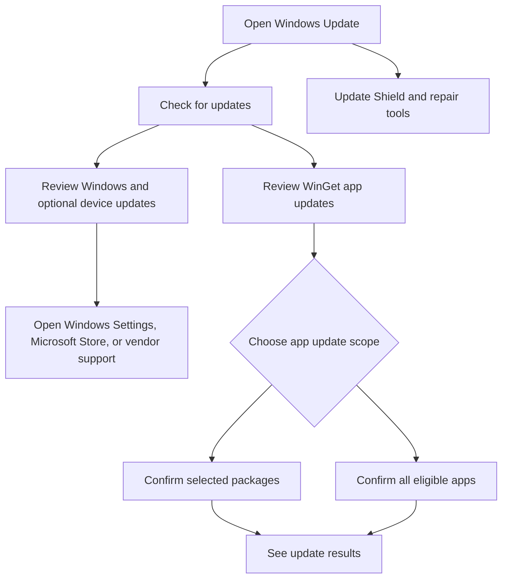

# Windows Update

Open **Maintenance → Windows Update** from the sidebar or use the tray shortcut. The page opens the **Updaters** tab of Software Hub. It keeps the original hero, with the update check and review below it. **Gaming Runtimes & Tools** opens the [app catalog](software-hub.md), and **Update Shield** opens policy and repair tools.

## Update flow

**Check for updates** reads the Windows Update catalog, WinGet inventory, and available device information. The page shows a separate status when a provider is unavailable, blocked, or returns an error. **Last checked** reflects an actual completed check.

- **Windows and device updates.** Review the Windows Update catalog, optional entries, detected graphics, and firmware information. Open Windows Update or Optional updates in Settings to install the Windows catalog results. Use the available graphics actions or the device maker's website for vendor packages. Firmware installation takes place in vendor tools.
- **Update selected apps.** Select eligible WinGet packages and review their exact identities and source before confirming. Excluded entries show the reason when AxePower can identify it. A failed scan or changed package list may require a new check.
- **Update all eligible apps.** Confirm a separate bulk WinGet operation. The **Include unknown installed versions** checkbox is off by default. Turning it on adds `--include-unknown` to the bulk command. WinGet applies its source, eligibility, and pinning rules. Both modes accept source and package agreements after confirmation.
- **Results.** The page keeps results for the current session, with per-package statuses for selected upgrades and a batch result for bulk mode. It shows failure, incomplete information, and restart requirements when available. You decide when to restart. Diagnostic output is also available in the [Terminal](terminal.md).

## Update Shield

| Control | Behavior |
| --- | --- |
| **Defer feature updates** | Requests a feature-update deferral through Windows policy. Its effect depends on the Windows edition, version, and effective management policy. |
| **Signed-in restart protection** | Requests protection for scheduled automatic update installs while someone is signed in. Windows and organization policies control when that protection applies. |
| **Reset & Repair Cache** | With administrator access and confirmation, temporarily stops update services, clears the download cache, and attempts to restore services to their prior state. Windows may have to download pending packages again. |
| **Create System Restore Point** | Requests an elevated System Restore point. Availability depends on Windows System Protection and policy. |

The policy, repair, and restore controls require administrator rights. Read-only checks and handoffs can still work where Windows allows them. WinGet app updates require App Installer and an available WinGet source for the signed-in user. See the [platform and validation matrix](../docs/engineering/WINDOWS_UPDATE_PLAN.md) for managed, offline, legacy Windows, and Arm64 coverage.

## Code and tests

| Area | Code | Tests |
| --- | --- | --- |
| Page and update workflow | [UpdatersTab.xaml](../AxePower.App/Views/SoftwareHub/UpdatersTab.xaml), [SoftwareHubViewModel.PcUpdates.cs](../AxePower.App/ViewModels/SoftwareHubViewModel.PcUpdates.cs) | [PcUpdatesViewTests.cs](../AxePower.Tests/Shell/PcUpdatesViewTests.cs) |
| Windows and firmware catalog | [WindowsUpdateCatalogService.cs](../AxePower.Core/Services/WindowsUpdateCatalogService.cs), [FirmwareUpdateService.cs](../AxePower.Core/Services/FirmwareUpdateService.cs) | [WindowsUpdateCatalogTests.cs](../AxePower.Tests/WindowsUpdateCatalogTests.cs), [FirmwareUpdateCatalogTests.cs](../AxePower.Tests/FirmwareUpdateCatalogTests.cs) |
| WinGet review and execution | [WinGetUpdateService.cs](../AxePower.Core/Services/SoftwareHub/WinGetUpdateService.cs) | [WinGetUpdateServiceTests.cs](../AxePower.Tests/SoftwareHub/WinGetUpdateServiceTests.cs) |
| Shield and restore points | [WindowsUpdateShieldService.cs](../AxePower.Core/Services/WindowsUpdateShieldService.cs), [RestorePointService.cs](../AxePower.Core/Services/RestorePointService.cs) | [WindowsUpdateShieldTests.cs](../AxePower.Tests/WindowsUpdateShieldTests.cs) |
